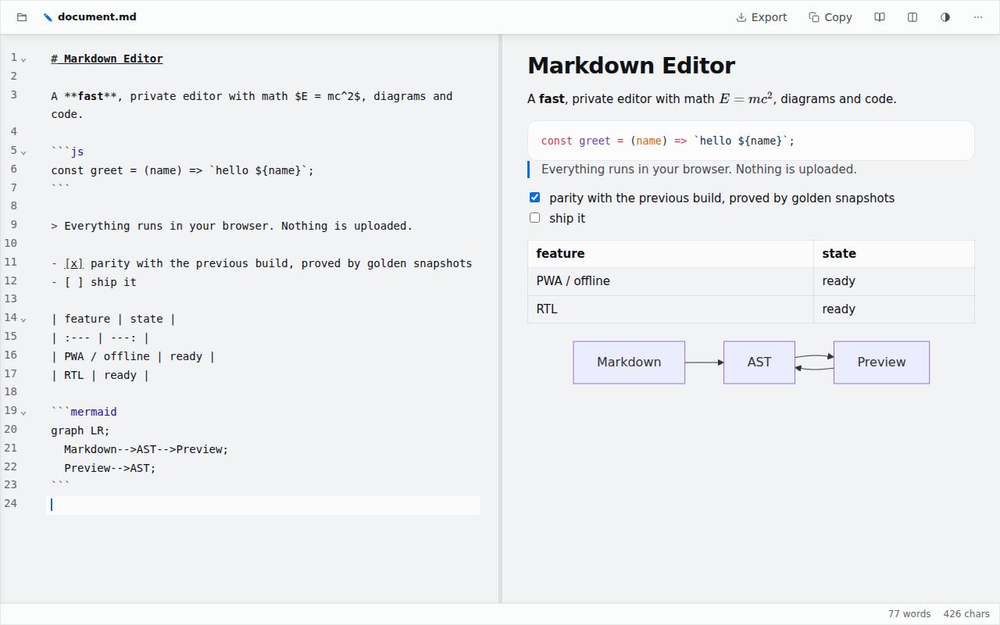

<div align="center">

# ✎ Markdown Editor

**A fast, no-nonsense markdown editor that runs entirely in your browser.**

No server. No account. Works offline. Just open it and write.

[**→ Try it live**](https://markdowneditor.ir/)

</div>



---

The right pane is not just a preview, you can write in it. Click in and type, or select text and a formatting toolbar appears; everything you do is written back as markdown on the left. The left pane is the markdown source, and the two stay in step. You can keep several documents open at once and switch between them from the explorer on the left.

Everything you open is saved in your own browser and never sent anywhere. There is no backend.

## Features

**Workspace**

- **Explorer**: keep several documents open at once, switch between them, create, rename and close them
- **Import**: open one or more `.md` files, or drag them onto the window
- **Autosave**: every open document is kept in this browser as you write, and the workspace comes back on your next visit

**Writing**

- **Live preview**: renders as you type, in a resizable split view
- **Editable preview**: type directly into the rendered side; it syncs back to markdown
- **Formatting toolbar**: select text or right-click inside the preview for bold, italic, code, headings (H1–H6), lists, links and tables
- **Find & replace**: `Ctrl/Cmd + F`, with a match count and undoable replacements
- **Smart lists**: Enter continues the current bullet, number or checkbox; Tab nests it

**Rendering**

- **Nested lists** and **checklists**: `- [ ]` / `- [x]` become real checkboxes you can tick
- **Tables** with `:---:` column alignment, or insert one at any size
- **Syntax highlighting**: name a language on a fence and the code is coloured
- **Mermaid diagrams**: a ```` ```mermaid ```` fence renders live (flowchart, sequence, class, gantt…)
- **LaTeX math**: inline `$…$` and display `$$…$$`, rendered with KaTeX
- **Footnotes**: `text[^1]` collects into a linked list at the end
- **Autolinks, reference links & inline HTML**: bare URLs become links, `[text][ref]` resolves against `[ref]: url`, and `<details>` blocks work

**Output**

- **Export**: Markdown, PDF (through the browser's own print engine, so the text stays selectable) or a self-contained HTML file
- **Copy**: as Markdown, HTML or plain text

**Comfort**

- **Reading mode**: distraction-free and editable by default; use the lock button for a fully read-only view
- **Dark & light themes**, remembered between visits
- **RTL / LTR**: full right-to-left support for Persian, Arabic and Hebrew, remembered independently for each document
- **Sync scroll** between the two panes (toggleable)
- **Install it**: it is a PWA, so it can be installed as an app and **works with no network at all**
- **Follows your system theme** by default, and remembers an explicit choice

## Markdown it understands

| Syntax | Result |
| --- | --- |
| `**bold**` `*italic*` `~~strike~~` | **bold** *italic* ~~strike~~ |
| `` `code` `` | inline code |
| `# H1` … `###### H6` | headings |
| `> quote` | blockquote |
| `- item` / `1. item` | lists, indent to nest |
| `- [ ]` / `- [x]` | checkboxes |
| `[text](url)` or a bare URL | links |
| `[text][ref]` + `[ref]: url` | reference links |
| `` | images |
| <code>\`\`\`js</code> | code block, highlighted |
| <code>\`\`\`mermaid</code> | diagram |
| `$x^2$` / `$$…$$` | math |
| `text[^1]` + `[^1]: note` | footnotes |
| `\|:---\|:---:\|---:\|` | table column alignment |

## Keyboard shortcuts

| Shortcut | Action |
| --- | --- |
| `Ctrl/Cmd + S` | Save as `.md` |
| `Ctrl/Cmd + F` | Find & replace |
| `Ctrl/Cmd + Z` | Undo, including Clear and Replace all |
| `Enter` | Continue the current list / checklist |
| `Tab` | Indent (nests a list item) |
| `Esc` | Close the find bar, a dialog, or reading mode |

## Privacy

Everything runs client-side. There is no analytics, no account, and no upload. Your documents live in this browser's local storage and nowhere else.

After the page has loaded, the app makes **no network request at all** — not even to a CDN. The diagram, math and highlighting libraries are bundled with the app and loaded from it, and only the first time a document actually uses one; a document with no diagram never costs you the diagram renderer.

## Development

```sh
npm install
npm run dev        # http://localhost:3000
npm test           # unit tests (Vitest)
npm run e2e        # end-to-end tests (Playwright, against the real static export)
npm run build      # static export into out/
```

The markdown engine is proved against the previous hand-written renderer: its
output was captured as golden snapshots before it was removed, and every render
is still compared against them. See `tests/golden/DIVERGENCES.md` for the
differences that are deliberate, and `DESIGN.md` for the design system.
