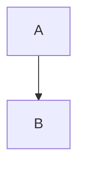

# Markdown Editor — Next.js + Tailwind Rewrite Implementation Plan

> **For agentic workers:** REQUIRED SUB-SKILL: Use superpowers:subagent-driven-development (recommended) or superpowers:executing-plans to implement this plan task-by-task. Steps use checkbox (`- [ ]`) syntax for tracking.

**Goal:** Rewrite the vanilla-JS markdown editor at `markdowneditor.ir` on Next.js 16 + Tailwind CSS 4 with an Apple/macOS-native design system and PWA support, at proven feature parity.

**Architecture:** A single statically-exported client-side route. The markdown engine moves from a hand-written renderer to unified/remark, with the reverse (preview -> markdown) path sharing the same AST configuration so round-trip editing cannot drift. Everything under `src/lib/` is pure and DOM-free so it is unit-testable without a browser; React components are a thin shell over those modules. Parity with the old build is proved by golden snapshots captured from the old renderer before it is deleted.

**Tech Stack:** Next.js 16.3.4, React 19.3.0, TypeScript 7.0.2, Tailwind CSS 4.3.3, unified 11 (remark-parse 11 / remark-gfm 4.0.1 / remark-math 6 / remark-frontmatter 5 / remark-rehype 11.1.2 / rehype-raw 7 / rehype-sanitize 6 / rehype-remark 10.0.1 / remark-stringify 11), CodeMirror 6, KaTeX 0.18.7, Mermaid 11.17.2, Shiki 4.4.3, Zustand 5.0.15, Serwist 9.5.12, Vitest 5, Playwright 1.63.

**Spec:** `docs/superpowers/specs/2026-09-09-nextjs-rewrite-design.md`

## Global Constraints

Every task's requirements implicitly include this section.

- **Static export only.** `output: 'export'` in `next.config.ts`. No route handlers, no server actions, no `next/image` loader that needs a server, no middleware. The build must produce a working `out/` directory.
- **No backend, no network at runtime.** All persistence is `localStorage`. No analytics, no telemetry, no CDN fetches. Every third-party library is bundled from our own origin.
- **localStorage key compatibility is mandatory.** Read and write exactly these keys, unchanged: `md-editor-files`, `md-editor-active-file`, `md-editor-theme`, `md-editor-dir`, `md-editor-split`, `md-editor-sync`, `md-editor-explorer`. `md-editor-content` is a legacy single-document key kept as a read-only migration fallback.
- **Document shape:** `{ id: string; name: string; content: string; dir: 'ltr' | 'rtl' }`.
- **TypeScript strict.** `strict: true` plus `noUncheckedIndexedAccess: true`. No `any`, no non-null assertion (`!`) except where a test proves the invariant.
- **Lazy libraries stay lazy.** Mermaid, KaTeX and Shiki load via dynamic `import()` only when a document actually needs them. A document with no diagram must fetch zero diagram bytes.
- **Lazy passes run after sanitization, never inside it.** They inject trusted library markup that the sanitizer would strip.
- **Animation is limited to `transform` and `opacity`.** Never animate `width`, `height`, `filter`, or `backdrop-filter`.
- **`prefers-reduced-motion: reduce`** reduces motion to a crossfade of <=100ms; it does not remove feedback.
- **Do not delete `app.js`, `styles.css` or `index.html`** until Task 27. They are the behavioral reference and the source of golden snapshots.
- **Commit after every task.** Conventional-commit prefixes (`feat:`, `test:`, `chore:`, `docs:`, `fix:`).

## File Structure

**Configuration**
- `package.json`, `next.config.ts`, `tsconfig.json`, `vitest.config.ts`, `playwright.config.ts`, `postcss.config.mjs`

**Pure library (no DOM, no React) — `src/lib/`**
- `markdown/sanitize-schema.ts` — rehype-sanitize schema, the allowlist
- `markdown/parse.ts` — markdown text -> sanitized HTML string + metadata
- `markdown/stringify.ts` — HTML string -> markdown text
- `markdown/plugins/front-matter.ts` — YAML block -> inert `data-fm` panel
- `markdown/plugins/footnotes.ts` — footnote anchors + `data-fn-src` round-trip data
- `markdown/plugins/lazy-blocks.ts` — `data-mmd` / `data-tex` / `data-lang` markers, `contenteditable="false"`
- `markdown/task-toggle.ts` — surgical `[ ]` <-> `[x]` edit on raw markdown
- `storage/keys.ts` — the localStorage key constants
- `storage/workspace.ts` — load/save documents, legacy migration
- `storage/prefs.ts` — theme, dir, split, sync, explorer
- `lazy/mermaid.ts`, `lazy/katex.ts`, `lazy/shiki.ts` — one shared `ensure` contract
- `export/html.ts`, `export/pdf.ts`, `export/markdown.ts`, `export/clipboard.ts`

**State — `src/state/`**
- `documents.ts` — zustand store: documents, active id, CRUD
- `ui.ts` — zustand store: theme, split, sync, reading, explorer

**Components — `src/components/`**
- `editor/CodeEditor.tsx`, `editor/extensions/smart-lists.ts`, `editor/extensions/find.ts`
- `preview/Preview.tsx`, `preview/useReturnPath.ts`, `preview/SelectionToolbar.tsx`
- `chrome/Sidebar.tsx`, `chrome/Toolbar.tsx`, `chrome/FindBar.tsx`, `chrome/StatusBar.tsx`, `chrome/Divider.tsx`, `chrome/ReadingControls.tsx`, `chrome/DropZone.tsx`
- `ui/Button.tsx`, `ui/Menu.tsx`, `ui/Dialog.tsx`, `ui/Toast.tsx`, `ui/Icon.tsx`

**App shell — `src/app/`**
- `layout.tsx` — metadata, fonts, theme bootstrap script
- `page.tsx` — the client shell
- `globals.css` — Tailwind v4 `@theme` tokens and base styles

**Docs**
- `DESIGN.md` — living design-system reference

**Tests**
- `tests/fixtures/*.md` — parity corpus
- `tests/golden/*.html` — captured legacy output
- `tests/unit/**` — Vitest
- `tests/e2e/**` — Playwright
- `scripts/capture-golden.mjs` — one-off legacy-output capture

---
### Task 1: Project scaffold that builds and exports

**Files:**
- Create: `package.json`, `next.config.ts`, `tsconfig.json`, `postcss.config.mjs`, `vitest.config.ts`
- Create: `src/app/layout.tsx`, `src/app/page.tsx`, `src/app/globals.css`
- Test: `tests/unit/smoke.test.ts`

**Interfaces:**
- Consumes: nothing.
- Produces: a buildable workspace. Scripts `npm run dev`, `npm run build`, `npm test`, `npm run e2e`. Path alias `@/*` -> `src/*`.

- [ ] **Step 1: Install dependencies**

The legacy files must survive, so scaffold in place rather than with `create-next-app` (which insists on an empty directory).

```bash
npm init -y
npm i next@16.3.4 react@19.3.0 react-dom@19.3.0 zustand@5.0.15
npm i unified@11.0.5 remark-parse@11.0.0 remark-gfm@4.0.1 remark-math@6.0.0 \
      remark-frontmatter@5.0.0 remark-rehype@11.1.2 rehype-raw@7.0.0 \
      rehype-sanitize@6.0.0 rehype-remark@10.0.1 remark-stringify@11.0.0 \
      unist-util-visit@5.0.0 hast-util-to-html@9.0.5 hast-util-from-html@2.0.3
npm i codemirror@6.0.2 @codemirror/state @codemirror/view @codemirror/commands \
      @codemirror/language @codemirror/search @codemirror/lang-markdown @lezer/highlight
npm i katex@0.18.7 mermaid@11.17.2 shiki@4.4.3
npm i -D typescript@7.0.2 @types/node @types/react @types/react-dom \
      tailwindcss@4.3.3 @tailwindcss/postcss vitest@5.0.0 jsdom @playwright/test@1.63.0
```

- [ ] **Step 2: Write the configuration files**

`package.json` scripts block:

```json
{
  "scripts": {
    "dev": "next dev",
    "build": "next build",
    "test": "vitest run",
    "test:watch": "vitest",
    "e2e": "playwright test",
    "capture-golden": "node scripts/capture-golden.mjs"
  }
}
```

`next.config.ts`:

```ts
import type { NextConfig } from 'next';

const config: NextConfig = {
  output: 'export',
  images: { unoptimized: true },
  reactStrictMode: true,
  experimental: { reactCompiler: true },
};

export default config;
```

`tsconfig.json`:

```json
{
  "compilerOptions": {
    "target": "ES2022",
    "lib": ["dom", "dom.iterable", "ES2022"],
    "allowJs": false,
    "skipLibCheck": true,
    "strict": true,
    "noUncheckedIndexedAccess": true,
    "noEmit": true,
    "esModuleInterop": true,
    "module": "esnext",
    "moduleResolution": "bundler",
    "resolveJsonModule": true,
    "isolatedModules": true,
    "jsx": "preserve",
    "incremental": true,
    "plugins": [{ "name": "next" }],
    "paths": { "@/*": ["./src/*"] }
  },
  "include": ["next-env.d.ts", "**/*.ts", "**/*.tsx", ".next/types/**/*.ts"],
  "exclude": ["node_modules", "app.js"]
}
```

`postcss.config.mjs`:

```js
export default { plugins: { '@tailwindcss/postcss': {} } };
```

`vitest.config.ts`:

```ts
import { defineConfig } from 'vitest/config';
import { resolve } from 'node:path';

export default defineConfig({
  resolve: { alias: { '@': resolve(import.meta.dirname, 'src') } },
  test: { environment: 'node', include: ['tests/unit/**/*.test.ts'] },
});
```

- [ ] **Step 3: Write the minimal app shell**

`src/app/globals.css`:

```css
@import 'tailwindcss';

@theme {
  --color-canvas: oklch(0.98 0.002 260);
  --color-text-primary: oklch(0.22 0.01 260);
}

html, body { height: 100%; }
body { background: var(--color-canvas); color: var(--color-text-primary); }
```

`src/app/layout.tsx`:

```tsx
import type { Metadata } from 'next';
import './globals.css';

export const metadata: Metadata = {
  title: 'Markdown Editor',
  description: 'A fast markdown editor that runs entirely in your browser.',
};

export default function RootLayout({ children }: { children: React.ReactNode }) {
  return (
    <html lang="en" suppressHydrationWarning>
      <body>{children}</body>
    </html>
  );
}
```

`src/app/page.tsx`:

```tsx
export const dynamic = 'force-static';

export default function Page() {
  return <main>Markdown Editor</main>;
}
```

- [ ] **Step 4: Write the smoke test**

`tests/unit/smoke.test.ts`:

```ts
import { describe, it, expect } from 'vitest';
import { readFileSync } from 'node:fs';

describe('scaffold', () => {
  it('configures a static export', () => {
    const config = readFileSync('next.config.ts', 'utf8');
    expect(config).toContain("output: 'export'");
  });

  it('keeps the legacy build in place as the parity reference', () => {
    expect(() => readFileSync('app.js', 'utf8')).not.toThrow();
  });
});
```

- [ ] **Step 5: Run the test and the build**

Run: `npm test`
Expected: 2 passing.

Run: `npm run build`
Expected: build succeeds and `out/index.html` exists. Verify with `test -f out/index.html && echo OK`.

- [ ] **Step 6: Commit**

```bash
git add -A
git commit -m "chore: scaffold Next.js 16 + Tailwind 4 static export"
```

---

### Task 2: Parity corpus and golden capture from the legacy renderer

This task must happen before any renderer work: it freezes the old behavior while the old code still exists.

**Files:**
- Create: `tests/fixtures/*.md` (13 files, listed below)
- Create: `scripts/capture-golden.mjs`
- Create: `tests/golden/*.html` (generated output, committed)
- Test: `tests/unit/golden-capture.test.ts`

**Interfaces:**
- Consumes: `app.js` section 1 (`render`, `sanitize`).
- Produces: `tests/golden/<name>.html` for each `tests/fixtures/<name>.md`, and a helper `loadFixtures(): { name: string; markdown: string; golden: string }[]` exported from `tests/unit/helpers/fixtures.ts`.

- [ ] **Step 1: Write the fixtures**

Create one file per case. Content is given in full; do not abbreviate.

`tests/fixtures/basic.md`:

```markdown
# Heading one

Some **bold**, some *italic*, some ~~strike~~ and some `code`.

> A quote.

---

[a link](https://example.com) and a bare URL https://example.org and 
```

`tests/fixtures/lists.md`:

```markdown
- one
- two
  - nested
    - deeper
- three

1. first
2. second
   1. sub

14. The number of doors is 6.
```

`tests/fixtures/tasks.md`:

```markdown
- [ ] not done
- [x] done
  - [ ] nested and not done
```

`tests/fixtures/tables.md`:

```markdown
| left | center | right |
| :--- | :----: | ----: |
| a    | b      | c     |
|      | empty  |       |
```

`tests/fixtures/code-spans.md`:

```markdown
A span with a backtick: ``a ` b``

A span that starts with a backtick: `` `x ``

An empty-ish span: ` `
```

`tests/fixtures/fences.md`:

````markdown
```js
const x = 1;
```

```
no language
```

    indented code block
````

`tests/fixtures/footnotes.md`:

```markdown
Text with a note[^a] and the same note again[^a] and another[^b].

[^a]: The first note.
[^b]: The second note,
    continued on the next line.
```

`tests/fixtures/front-matter.md`:

```markdown
---
title: Hello
tags: [a, b]
---

# After the front matter
```

`tests/fixtures/reference-links.md`:

```markdown
See [the docs][docs] and [the docs][DOCS] and ![the logo][logo].

[docs]: https://example.com/docs "Docs"
[logo]: https://example.com/logo.png
```

`tests/fixtures/raw-html.md`:

```markdown
<details>
<summary>Click me</summary>

Hidden content with <kbd>Ctrl</kbd> and H<sub>2</sub>O and x<sup>2</sup>.

</details>

- a list item with <mark>marked</mark> text
```

`tests/fixtures/math.md`:

```markdown
Inline $x^2 + y^2 = z^2$ math.

$$
\int_0^1 x \, dx = \frac{1}{2}
$$

A lone $ sign that is not math. Costs $5 and $10.
```

`tests/fixtures/mermaid.md`:

````markdown

````

`tests/fixtures/unsafe.md`:

```markdown
[click](javascript:alert(1))

[vb](vbscript:msgbox(1))

[data](data:text/html,<script>alert(1)</script>)


<a href="#" onclick="alert(1)">handler</a>

<script>alert(1)</script>

<div id="editor">id collision</div>
```

- [ ] **Step 2: Write the capture script**

The legacy renderer is inside an IIFE and exports nothing. Section 1 (the renderer and sanitizer) is self-contained and ends at the `2. UI helpers` banner, so slice it out and evaluate that slice with a jsdom `DOMParser` in scope.

`scripts/capture-golden.mjs`:

```js
import { readFileSync, writeFileSync, readdirSync, mkdirSync } from 'node:fs';
import { join } from 'node:path';
import { JSDOM } from 'jsdom';

const SECTION_2_BANNER = '   2. UI helpers';

const source = readFileSync('app.js', 'utf8');
const cut = source.indexOf(SECTION_2_BANNER);
if (cut === -1) throw new Error('could not find the section 2 banner in app.js');

// Section 1 starts after the file-level banner and the IIFE opener.
const bodyStart = source.indexOf('function escapeHtml');
if (bodyStart === -1) throw new Error('could not find escapeHtml in app.js');

const section1 = source.slice(bodyStart, cut);
const dom = new JSDOM('');
const factory = new Function(
  'DOMParser',
  `${section1}\n;return { render, sanitize };`
);
const { render, sanitize } = factory(dom.window.DOMParser);

mkdirSync('tests/golden', { recursive: true });
for (const file of readdirSync('tests/fixtures').filter((f) => f.endsWith('.md'))) {
  const markdown = readFileSync(join('tests/fixtures', file), 'utf8');
  const html = sanitize(render(markdown));
  writeFileSync(join('tests/golden', file.replace(/\.md$/, '.html')), html + '\n');
  console.log('captured', file);
}
```

- [ ] **Step 3: Run the capture**

Run: `npm run capture-golden`
Expected: 13 lines of `captured <name>.md`, and 13 files in `tests/golden/`.

Inspect `tests/golden/unsafe.html` by eye and confirm: no `<script>`, no `onerror`, no `onclick`, `javascript:`/`vbscript:`/`data:text/html` hrefs replaced with `#`, the `data:image/png` src kept, and `id="editor"` removed.

- [ ] **Step 4: Write the fixtures helper and its test**

`tests/unit/helpers/fixtures.ts`:

```ts
import { readFileSync, readdirSync } from 'node:fs';
import { join } from 'node:path';

export interface Fixture {
  name: string;
  markdown: string;
  golden: string;
}

export function loadFixtures(): Fixture[] {
  return readdirSync('tests/fixtures')
    .filter((f) => f.endsWith('.md'))
    .sort()
    .map((f) => {
      const name = f.replace(/\.md$/, '');
      return {
        name,
        markdown: readFileSync(join('tests/fixtures', f), 'utf8'),
        golden: readFileSync(join('tests/golden', `${name}.html`), 'utf8').trimEnd(),
      };
    });
}
```

`tests/unit/golden-capture.test.ts`:

```ts
import { describe, it, expect } from 'vitest';
import { loadFixtures } from './helpers/fixtures';

describe('golden corpus', () => {
  const fixtures = loadFixtures();

  it('captured every fixture', () => {
    expect(fixtures).toHaveLength(13);
    expect(fixtures.map((f) => f.name)).toContain('unsafe');
  });

  it('stripped every executable surface from the unsafe fixture', () => {
    const unsafe = fixtures.find((f) => f.name === 'unsafe');
    expect(unsafe).toBeDefined();
    const html = unsafe!.golden;
    expect(html).not.toMatch(/<script/i);
    expect(html).not.toMatch(/onerror/i);
    expect(html).not.toMatch(/onclick/i);
    expect(html).not.toMatch(/javascript:/i);
    expect(html).not.toMatch(/vbscript:/i);
    expect(html).not.toMatch(/id="editor"/);
    expect(html).toMatch(/data:image\/png/);
  });
});
```

- [ ] **Step 5: Run the tests**

Run: `npm test`
Expected: PASS. If the unsafe assertions fail, the capture is wrong — fix the script before continuing, because every later parity claim rests on this file.

- [ ] **Step 6: Commit**

```bash
git add tests/fixtures tests/golden tests/unit scripts package.json
git commit -m "test: capture golden output from the legacy renderer as the parity baseline"
```

---
### Task 3: Sanitize schema

**Files:**
- Create: `src/lib/markdown/sanitize-schema.ts`
- Test: `tests/unit/markdown/sanitize-schema.test.ts`

**Interfaces:**
- Consumes: nothing.
- Produces: `export const schema: Schema` (a `hast-util-sanitize` schema) and `export const FOOTNOTE_ANCHOR: RegExp`.

The allowlist is transcribed from `app.js` (`ALLOWED_TAGS`, `ALLOWED_ATTRS`, `FOOTNOTE_ANCHOR`). Do not add tags that are not in this list, and do not drop any.

- [ ] **Step 1: Write the failing test**

`tests/unit/markdown/sanitize-schema.test.ts`:

```ts
import { describe, it, expect } from 'vitest';
import { schema, FOOTNOTE_ANCHOR } from '@/lib/markdown/sanitize-schema';

describe('sanitize schema', () => {
  it('allows exactly the legacy tag set', () => {
    expect(schema.tagNames).toContain('details');
    expect(schema.tagNames).toContain('summary');
    expect(schema.tagNames).toContain('kbd');
    expect(schema.tagNames).toContain('input');
    expect(schema.tagNames).not.toContain('script');
    expect(schema.tagNames).not.toContain('style');
    expect(schema.tagNames).not.toContain('iframe');
    expect(schema.tagNames).toContain('section'); // needed by the front-matter panel
    expect(schema.tagNames).toHaveLength(53);
  });

  it('carries the round-trip data attributes', () => {
    const global = schema.attributes?.['*'] ?? [];
    expect(global).toContain('data-mmd');
    expect(global).toContain('data-tex');
    expect(global).toContain('data-fm');
    expect(global).toContain('data-fn');
    expect(global).toContain('data-fn-src');
    expect(global).toContain('aria-label');
    expect(global).not.toContain('style');
  });

  it('restricts href and src to safe schemes', () => {
    expect(schema.protocols?.href).toEqual(['http', 'https', 'mailto', 'tel']);
    expect(schema.protocols?.src).toEqual(['http', 'https']);
  });

  it('matches only generated footnote ids', () => {
    expect(FOOTNOTE_ANCHOR.test('fn-1')).toBe(true);
    expect(FOOTNOTE_ANCHOR.test('fnref-12')).toBe(true);
    expect(FOOTNOTE_ANCHOR.test('editor')).toBe(false);
    expect(FOOTNOTE_ANCHOR.test('fn-')).toBe(false);
  });
});
```

- [ ] **Step 2: Run it to verify it fails**

Run: `npx vitest run tests/unit/markdown/sanitize-schema.test.ts`
Expected: FAIL, cannot resolve `@/lib/markdown/sanitize-schema`.

- [ ] **Step 3: Write the implementation**

`src/lib/markdown/sanitize-schema.ts`:

```ts
import type { Schema } from 'hast-util-sanitize';

/* An arbitrary id from a document could shadow one of the app's own elements in
   a later getElementById lookup, so only the ids the renderer generates survive. */
export const FOOTNOTE_ANCHOR = /^fn(ref)?-\d+$/;

/* Transcribed from the legacy ALLOWED_TAGS. `input` is here because task-list
   checkboxes are real inputs; `disabled` and `checked` keep them inert. */
const TAG_NAMES = [
  'a', 'abbr', 'b', 'blockquote', 'br', 'caption', 'code', 'dd', 'del',
  'details', 'div', 'dl', 'dt', 'em', 'figcaption', 'figure', 'h1', 'h2', 'h3',
  'h4', 'h5', 'h6', 'hr', 'i', 'img', 'input', 'ins', 'kbd', 'li', 'mark', 'ol',
  'p', 'picture', 'pre', 'q', 's', 'samp', 'section', 'small', 'source', 'span',
  'strong', 'sub', 'summary', 'sup', 'table', 'tbody', 'td', 'tfoot', 'th',
  'thead', 'tr', 'u', 'ul', 'var',
];

const GLOBAL_ATTRIBUTES = [
  'align', 'alt', 'checked', 'className', 'colSpan', 'dir', 'disabled',
  'height', 'href', 'open', 'rel', 'rowSpan', 'span', 'src', 'srcSet', 'start',
  'target', 'title', 'type', 'width',
  'data-mmd',    // inert diagram source — carries no executable surface
  'data-tex',    // inert math source — same story
  'data-fm',     // inert front-matter source, for the round trip
  'data-fn',     // footnote label, for the round trip
  'data-fn-src', // footnote markdown source, for the round trip
  'data-lang',   // fence language, read by the lazy highlighter
  'contentEditable',
  'aria-label',
  'aria-hidden',
];

export const schema: Schema = {
  tagNames: TAG_NAMES,
  attributes: { '*': GLOBAL_ATTRIBUTES, a: ['href'], img: ['src'] },
  protocols: {
    href: ['http', 'https', 'mailto', 'tel'],
    src: ['http', 'https'],
  },
  clobberPrefix: '',      // we police ids ourselves, see id-guard below
  strip: ['script', 'style'],
  allowComments: false,
};
```

- [ ] **Step 4: Add the id guard**

`rehype-sanitize` drops `id` entirely unless allowed, and allowing it wholesale reintroduces the DOM-clobbering hazard the legacy comment describes. So `id` is *not* in the attribute list; instead it is reattached after sanitization by the footnotes plugin (Task 6), which is the only code that generates ids. Add this comment above `GLOBAL_ATTRIBUTES`:

```ts
/* `id` is deliberately absent. Footnote anchors are the only generated ids, and
   the footnotes plugin reattaches them after sanitization, so a document can
   never inject an id that shadows one of the app's own elements. */
```

- [ ] **Step 5: Run the test**

Run: `npx vitest run tests/unit/markdown/sanitize-schema.test.ts`
Expected: PASS (4 tests).

- [ ] **Step 6: Commit**

```bash
git add src/lib/markdown/sanitize-schema.ts tests/unit/markdown/sanitize-schema.test.ts
git commit -m "feat: sanitize schema transcribed from the legacy allowlist"
```

---

### Task 4: Core parse pipeline

**Files:**
- Create: `src/lib/markdown/parse.ts`
- Create: `tests/unit/helpers/normalize.ts`
- Create: `tests/golden/DIVERGENCES.md`
- Test: `tests/unit/markdown/parse.test.ts`, `tests/unit/markdown/parity.test.ts`

**Interfaces:**
- Consumes: `schema` from Task 3.
- Produces: `export function parse(markdown: string): string` returning sanitized HTML. Later tasks add plugins to the pipeline defined here; the pipeline is built by `export function pipeline(): Processor` so plugins can be inserted in one place.

**On parity:** remark is CommonMark-correct where the legacy renderer was ad hoc, so byte-identical output is neither achievable nor desirable. The parity test compares *normalized* HTML — insignificant whitespace collapsed, attribute order sorted — and every remaining difference must be written down in `tests/golden/DIVERGENCES.md` with a one-line justification. An undocumented difference fails the test. That is what turns "no bugs" into something a reviewer can check.

- [ ] **Step 1: Write the normalizer**

`tests/unit/helpers/normalize.ts`:

```ts
/** Collapses formatting-only differences so parity compares structure, not bytes. */
export function normalizeHtml(html: string): string {
  return html
    .replace(/\s+/g, ' ')
    .replace(/>\s+</g, '><')
    .replace(/\s+>/g, '>')
    .trim();
}

/** Element names and their nesting, ignoring attributes and text. */
export function structureOf(html: string): string[] {
  return [...html.matchAll(/<([a-z][a-z0-9]*)\b/gi)].map((m) => m[1]!.toLowerCase());
}
```

- [ ] **Step 2: Write the failing tests**

`tests/unit/markdown/parse.test.ts`:

```ts
import { describe, it, expect } from 'vitest';
import { parse } from '@/lib/markdown/parse';

describe('parse', () => {
  it('renders emphasis, strong and strikethrough', () => {
    expect(parse('**b** *i* ~~s~~')).toContain('<strong>b</strong>');
    expect(parse('**b** *i* ~~s~~')).toContain('<em>i</em>');
    expect(parse('**b** *i* ~~s~~')).toContain('<del>s</del>');
  });

  it('renders a table with column alignment', () => {
    const html = parse('| a | b |\n| :--- | ---: |\n| 1 | 2 |');
    expect(html).toContain('<table>');
    expect(html).toContain('align="left"');
    expect(html).toContain('align="right"');
  });

  it('renders task list items as disabled checkboxes', () => {
    const html = parse('- [ ] todo\n- [x] done');
    expect(html).toContain('type="checkbox"');
    expect(html).toContain('disabled');
    expect(html).toContain('checked');
  });

  it('autolinks a bare URL', () => {
    expect(parse('see https://example.com now')).toContain('href="https://example.com"');
  });

  it('resolves a reference link case-insensitively', () => {
    const html = parse('[t][DOCS]\n\n[docs]: https://example.com');
    expect(html).toContain('href="https://example.com"');
  });

  it('keeps allowed raw HTML and drops the rest', () => {
    expect(parse('<kbd>Ctrl</kbd>')).toContain('<kbd>Ctrl</kbd>');
    expect(parse('<script>alert(1)</script>')).not.toContain('alert(1)');
    expect(parse('')).not.toContain('onerror');
  });

  it('neutralizes unsafe schemes but keeps inline images', () => {
    expect(parse('[c](javascript:alert(1))')).not.toContain('javascript:');
    expect(parse('')).toContain('data:image/png');
  });

  it('never emits an id from document content', () => {
    expect(parse('<div id="editor">x</div>')).not.toContain('id="editor"');
  });
});
```

`tests/unit/markdown/parity.test.ts`:

```ts
import { describe, it, expect } from 'vitest';
import { readFileSync } from 'node:fs';
import { parse } from '@/lib/markdown/parse';
import { loadFixtures } from '../helpers/fixtures';
import { structureOf } from '../helpers/normalize';

const divergences = readFileSync('tests/golden/DIVERGENCES.md', 'utf8');

describe('parity with the legacy renderer', () => {
  for (const fixture of loadFixtures()) {
    it(`${fixture.name}: every element the legacy renderer produced still appears`, () => {
      const legacy = new Set(structureOf(fixture.golden));
      const next = new Set(structureOf(parse(fixture.markdown)));
      const missing = [...legacy].filter((tag) => !next.has(tag));
      const undocumented = missing.filter(
        (tag) => !divergences.includes(`${fixture.name}: ${tag}`)
      );
      expect(undocumented).toEqual([]);
    });
  }
});
```

- [ ] **Step 3: Seed the divergences file**

`tests/golden/DIVERGENCES.md`:

```markdown
# Intentional divergences from the legacy renderer

Every entry is a documented, deliberate difference. Format: `<fixture>: <tag>` on
its own line, followed by the reason. The parity test fails on any difference not
listed here.

(none yet — add entries as they are found, with a justification)
```

- [ ] **Step 4: Run the tests to verify they fail**

Run: `npx vitest run tests/unit/markdown/`
Expected: FAIL, cannot resolve `@/lib/markdown/parse`.

- [ ] **Step 5: Write the implementation**

`src/lib/markdown/parse.ts`:

```ts
import { unified, type Processor } from 'unified';
import remarkParse from 'remark-parse';
import remarkGfm from 'remark-gfm';
import remarkRehype from 'remark-rehype';
import rehypeRaw from 'rehype-raw';
import rehypeSanitize from 'rehype-sanitize';
import rehypeStringify from 'rehype-stringify';
import { schema } from './sanitize-schema';

/* Built as a function rather than a module-level constant so later plugins have
   one place to slot in, and so a processor is never shared across a re-entrant
   render. */
export function pipeline() {
  return unified()
    .use(remarkParse)
    .use(remarkGfm)
    .use(remarkRehype, { allowDangerousHtml: true })
    .use(rehypeRaw)
    .use(rehypeSanitize, schema)
    .use(rehypeStringify, { allowDangerousHtml: false });
}

export function parse(markdown: string): string {
  return String(pipeline().processSync(markdown));
}
```

Add `rehype-stringify` to the dependencies:

```bash
npm i rehype-stringify@10.0.1
```

- [ ] **Step 6: Run the tests and reconcile parity**

Run: `npx vitest run tests/unit/markdown/`

The `parse.test.ts` cases must all pass. For `parity.test.ts`, each failure names a tag the legacy renderer emitted that the new pipeline does not. Resolve each one by either fixing the pipeline or adding a justified entry to `DIVERGENCES.md`. Expected outcomes for this task:

- `front-matter: pre` — will fail until Task 5. Add a placeholder entry now and **remove it in Task 5**; note that in the file.
- `footnotes: sup`, `footnotes: section` — will fail until Task 6, same treatment.
- `math: span`, `mermaid: pre` — will fail until Task 7, same treatment.

Every other fixture must pass without an entry. Do not add entries to silence a genuine gap in `basic`, `lists`, `tasks`, `tables`, `code-spans`, `fences`, `reference-links`, `raw-html` or `unsafe`.

- [ ] **Step 7: Commit**

```bash
git add src/lib/markdown/parse.ts tests/unit/ tests/golden/DIVERGENCES.md package.json
git commit -m "feat: core remark/rehype parse pipeline with parity harness"
```

---
### Task 5: Front matter plugin

**Files:**
- Create: `src/lib/markdown/plugins/front-matter.ts`
- Modify: `src/lib/markdown/parse.ts` (add `remarkFrontmatter` and the rehype plugin)
- Test: `tests/unit/markdown/front-matter.test.ts`

**Interfaces:**
- Consumes: `pipeline()` from Task 4.
- Produces: `export function rehypeFrontMatter(): (tree: Root) => void`. Renders the leading YAML block as `<pre class="front-matter" contenteditable="false" data-fm="<source>">`, matching the legacy shape so the round trip in Task 8 can restore it.

- [ ] **Step 1: Write the failing test**

```ts
import { describe, it, expect } from 'vitest';
import { parse } from '@/lib/markdown/parse';

describe('front matter', () => {
  const doc = '---\ntitle: Hello\ntags: [a, b]\n---\n\n# After\n';

  it('renders the block as an inert panel carrying its source', () => {
    const html = parse(doc);
    expect(html).toContain('class="front-matter"');
    expect(html).toContain('contenteditable="false"');
    expect(html).toContain('data-fm="title: Hello&#x0A;tags: [a, b]"');
  });

  it('still renders the body after it', () => {
    expect(parse(doc)).toContain('<h1>After</h1>');
  });

  it('leaves a thematic break alone when it is not front matter', () => {
    const html = parse('text\n\n---\n\nmore\n');
    expect(html).toContain('<hr>');
    expect(html).not.toContain('front-matter');
  });
});
```

- [ ] **Step 2: Run it to verify it fails**

Run: `npx vitest run tests/unit/markdown/front-matter.test.ts`
Expected: FAIL — no `front-matter` class in the output.

- [ ] **Step 3: Write the plugin**

`src/lib/markdown/plugins/front-matter.ts`:

```ts
import { visit } from 'unist-util-visit';
import type { Root, Element } from 'hast';

/* remark-frontmatter parses the leading --- … --- block into a `yaml` node, and
   remark-rehype drops it. Re-add it as a locked panel: data-fm carries the
   source verbatim so a preview edit round-trips it instead of losing it. */
export function rehypeFrontMatter() {
  return (tree: Root, file: { data: Record<string, unknown> }) => {
    const source = file.data.frontMatterSource;
    if (typeof source !== 'string') return;
    const panel: Element = {
      type: 'element',
      tagName: 'pre',
      properties: {
        className: ['front-matter'],
        contentEditable: 'false',
        'data-fm': source,
      },
      children: [{ type: 'text', value: source }],
    };
    tree.children.unshift(panel);
  };
}

/* Runs on the mdast side, before remark-rehype discards the node. */
export function remarkCaptureFrontMatter() {
  return (tree: Root, file: { data: Record<string, unknown> }) => {
    visit(tree as never, 'yaml', (node: { value: string }) => {
      file.data.frontMatterSource = node.value;
    });
  };
}
```

- [ ] **Step 4: Wire it into the pipeline**

In `src/lib/markdown/parse.ts`, add the imports and insert the two plugins:

```ts
import remarkFrontmatter from 'remark-frontmatter';
import { remarkCaptureFrontMatter, rehypeFrontMatter } from './plugins/front-matter';
```

and inside `pipeline()`, between `remarkGfm` and `remarkRehype`:

```ts
    .use(remarkFrontmatter, ['yaml'])
    .use(remarkCaptureFrontMatter)
```

and after `rehypeRaw`, before `rehypeSanitize`:

```ts
    .use(rehypeFrontMatter)
```

- [ ] **Step 5: Run the tests**

Run: `npx vitest run tests/unit/markdown/`
Expected: PASS, including the `front-matter` parity fixture. Remove the `front-matter: pre` placeholder entry from `tests/golden/DIVERGENCES.md`.

- [ ] **Step 6: Commit**

```bash
git add src/lib/markdown tests/unit/markdown tests/golden/DIVERGENCES.md
git commit -m "feat: render YAML front matter as an inert round-trippable panel"
```

---

### Task 6: Footnotes plugin

**Files:**
- Create: `src/lib/markdown/plugins/footnotes.ts`
- Modify: `src/lib/markdown/parse.ts`
- Test: `tests/unit/markdown/footnotes.test.ts`

**Interfaces:**
- Consumes: `pipeline()`, `FOOTNOTE_ANCHOR` from Task 3.
- Produces: `export function rehypeFootnotes(): (tree: Root) => void`. Runs **after** sanitization (it is the only code allowed to add `id`), reshaping GFM footnote output into the legacy shape: `<sup class="fn-ref" id="fnref-N" data-fn="label"><a href="#fn-N">N</a></sup>` for references and `<li id="fn-N" data-fn="label" data-fn-src="…">` for definitions, wrapped in `<section class="footnotes" contenteditable="false">` preceded by `<hr class="fn-sep">`.

- [ ] **Step 1: Write the failing test**

```ts
import { describe, it, expect } from 'vitest';
import { parse } from '@/lib/markdown/parse';

const doc = 'One[^a] and again[^a] and two[^b].\n\n[^a]: First.\n[^b]: Second.\n';

describe('footnotes', () => {
  it('numbers by first use and links reference to definition', () => {
    const html = parse(doc);
    expect(html).toContain('id="fnref-1"');
    expect(html).toContain('href="#fn-1"');
    expect(html).toContain('id="fn-1"');
    expect(html).toContain('id="fn-2"');
  });

  it('gives only the first reference of a label an id', () => {
    const html = parse(doc);
    expect(html.match(/id="fnref-1"/g)).toHaveLength(1);
  });

  it('carries the label and markdown source for the round trip', () => {
    const html = parse(doc);
    expect(html).toContain('data-fn="a"');
    expect(html).toContain('data-fn-src="First."');
  });

  it('locks the generated list against direct editing', () => {
    expect(parse(doc)).toContain('class="footnotes" contenteditable="false"');
  });

  it('emits no footnote section when the document has none', () => {
    expect(parse('plain text')).not.toContain('footnotes');
  });

  it('drops a reference whose label was never defined', () => {
    expect(parse('text[^missing]')).not.toContain('fnref-');
  });
});
```

- [ ] **Step 2: Run it to verify it fails**

Run: `npx vitest run tests/unit/markdown/footnotes.test.ts`
Expected: FAIL — GFM's default ids are `user-content-fn-a`, not `fn-1`.

- [ ] **Step 3: Write the plugin**

`src/lib/markdown/plugins/footnotes.ts`:

```ts
import { visit } from 'unist-util-visit';
import { toString } from 'hast-util-to-string';
import type { Root, Element } from 'hast';

const isElement = (n: unknown): n is Element =>
  typeof n === 'object' && n !== null && (n as Element).type === 'element';

const classesOf = (el: Element): string[] => {
  const c = el.properties?.className;
  return Array.isArray(c) ? c.map(String) : typeof c === 'string' ? c.split(' ') : [];
};

/* remark-gfm emits ids like `user-content-fn-<label>` and a
   <section class="footnotes"> at the end. Reshape both into the legacy spelling
   so styling, back-links and the return path all keep working, and number by
   first use rather than by definition order. This plugin runs after sanitize
   because it is the only code permitted to introduce an id. */
export function rehypeFootnotes() {
  return (tree: Root) => {
    const numbers = new Map<string, number>();
    const seen = new Set<string>();

    visit(tree, 'element', (node) => {
      if (node.tagName !== 'a') return;
      const href = node.properties?.href;
      if (typeof href !== 'string' || !href.startsWith('#user-content-fn-')) return;
      const label = decodeURIComponent(href.slice('#user-content-fn-'.length));
      let n = numbers.get(label);
      if (n === undefined) { n = numbers.size + 1; numbers.set(label, n); }
      node.properties = { href: `#fn-${n}` };
      node.children = [{ type: 'text', value: String(n) }];
    });

    visit(tree, 'element', (node, index, parent) => {
      if (node.tagName !== 'sup' || !parent || index === undefined) return;
      const link = node.children.find(isElement);
      const href = link?.properties?.href;
      if (typeof href !== 'string' || !href.startsWith('#fn-')) return;
      const n = Number(href.slice(4));
      const label = [...numbers].find(([, v]) => v === n)?.[0] ?? '';
      const first = !seen.has(label);
      seen.add(label);
      node.properties = {
        className: ['fn-ref'],
        'data-fn': label,
        ...(first ? { id: `fnref-${n}` } : {}),
      };
    });

    visit(tree, 'element', (node) => {
      if (node.tagName !== 'section' || !classesOf(node).includes('footnotes')) return;
      node.properties = { className: ['footnotes'], contentEditable: 'false' };
      visit(node, 'element', (li) => {
        if (li.tagName !== 'li') return;
        const id = li.properties?.id;
        if (typeof id !== 'string' || !id.startsWith('user-content-fn-')) return;
        const label = decodeURIComponent(id.slice('user-content-fn-'.length));
        const n = numbers.get(label);
        if (n === undefined) { li.properties = {}; return; }
        li.properties = { id: `fn-${n}`, 'data-fn': label, 'data-fn-src': toString(li).trim() };
      });
    });
  };
}
```

Add the dependency:

```bash
npm i hast-util-to-string@3.0.1
```

- [ ] **Step 4: Wire it in after sanitization**

In `pipeline()`, add after `.use(rehypeSanitize, schema)`:

```ts
    .use(rehypeFootnotes)
```

Add a comment above it:

```ts
    /* After sanitize on purpose: this is the only code allowed to add an id, and
       the schema deliberately strips ids that came from the document. */
```

- [ ] **Step 5: Run the tests**

Run: `npx vitest run tests/unit/markdown/`
Expected: PASS. Remove `footnotes: sup` and `footnotes: section` from `DIVERGENCES.md`.

The back-link arrow GFM appends inside each definition (`<a href="#user-content-fnref-a">`) will still point at a stale target. Fix it in the same `section` visitor by rewriting any `href` starting `#user-content-fnref-` to `#fnref-${n}`, and add a test:

```ts
  it('points the back-link at the first reference', () => {
    expect(parse(doc)).toContain('href="#fnref-1"');
  });
```

- [ ] **Step 6: Commit**

```bash
git add src/lib/markdown tests/unit/markdown tests/golden/DIVERGENCES.md package.json
git commit -m "feat: reshape GFM footnotes into the legacy anchor and round-trip shape"
```

---

### Task 7: Lazy-block markers

**Files:**
- Create: `src/lib/markdown/plugins/lazy-blocks.ts`
- Modify: `src/lib/markdown/parse.ts`
- Test: `tests/unit/markdown/lazy-blocks.test.ts`

**Interfaces:**
- Consumes: `pipeline()`.
- Produces: `export function rehypeLazyBlocks(): (tree: Root) => void`. Marks the three lazy render targets so the browser-side passes can find them without re-parsing: a mermaid fence becomes `<div class="mermaid-block" contenteditable="false" data-mmd="<source>">`, math becomes `<span class="math" data-tex="…">` / `<div class="math-display" contenteditable="false" data-tex="…">`, and a language-tagged fence gets `data-lang` on its `<code>`.

- [ ] **Step 1: Write the failing test**

```ts
import { describe, it, expect } from 'vitest';
import { parse } from '@/lib/markdown/parse';

describe('lazy blocks', () => {
  it('marks a mermaid fence and keeps its source', () => {
    const html = parse('```mermaid\ngraph TD;\n  A-->B;\n```');
    expect(html).toContain('class="mermaid-block"');
    expect(html).toContain('contenteditable="false"');
    expect(html).toContain('data-mmd="graph TD;&#x0A;  A--&#x3E;B;"');
  });

  it('marks inline and display math', () => {
    expect(parse('$x^2$')).toContain('data-tex="x^2"');
    expect(parse('$$\nx^2\n$$')).toContain('class="math-display"');
  });

  it('does not treat a lone dollar sign as math', () => {
    const html = parse('Costs $5 and $10 today.');
    expect(html).not.toContain('data-tex');
    expect(html).toContain('Costs $5 and $10 today.');
  });

  it('tags a fence language for the highlighter', () => {
    expect(parse('```js\nconst x = 1;\n```')).toContain('data-lang="js"');
  });

  it('leaves an untagged fence without a language marker', () => {
    expect(parse('```\nplain\n```')).not.toContain('data-lang');
  });
});
```

- [ ] **Step 2: Run it to verify it fails**

Run: `npx vitest run tests/unit/markdown/lazy-blocks.test.ts`
Expected: FAIL — no `mermaid-block` class.

- [ ] **Step 3: Write the plugin**

`src/lib/markdown/plugins/lazy-blocks.ts`:

```ts
import { visit } from 'unist-util-visit';
import { toString } from 'hast-util-to-string';
import type { Root, Element } from 'hast';

const isElement = (n: unknown): n is Element =>
  typeof n === 'object' && n !== null && (n as Element).type === 'element';

const classesOf = (el: Element): string[] => {
  const c = el.properties?.className;
  return Array.isArray(c) ? c.map(String) : typeof c === 'string' ? c.split(' ') : [];
};

/* The three lazy renderers (mermaid, KaTeX, Shiki) run in the browser after this
   HTML is in the DOM. They find their work by these markers rather than by
   re-parsing, and the data-* attributes keep the original source so a preview
   edit can round-trip a block the user cannot type into. */
export function rehypeLazyBlocks() {
  return (tree: Root) => {
    visit(tree, 'element', (node, index, parent) => {
      if (node.tagName !== 'pre' || !parent || index === undefined) return;
      const code = node.children.find(isElement);
      if (!code || code.tagName !== 'code') return;

      const language = classesOf(code)
        .find((c) => c.startsWith('language-'))
        ?.slice('language-'.length);
      if (!language) return;

      if (language === 'mermaid') {
        const source = toString(code).replace(/\n$/, '');
        parent.children[index] = {
          type: 'element',
          tagName: 'div',
          properties: {
            className: ['mermaid-block'],
            contentEditable: 'false',
            'data-mmd': source,
          },
          children: [{ type: 'text', value: source }],
        };
        return;
      }
      code.properties = { ...code.properties, 'data-lang': language };
    });

    // remark-math emits <span class="math math-inline"> / <div class="math-display">
    visit(tree, 'element', (node) => {
      const classes = classesOf(node);
      if (!classes.includes('math')) return;
      const source = toString(node).trim();
      const display = classes.includes('math-display');
      node.properties = {
        className: [display ? 'math-display' : 'math'],
        'data-tex': source,
        ...(display ? { contentEditable: 'false' } : {}),
      };
    });
  };
}
```

- [ ] **Step 4: Wire it in**

Add `remarkMath` to the remark half of `pipeline()`, right after `remarkGfm`:

```ts
    .use(remarkMath, { singleDollarTextMath: true })
```

and `rehypeLazyBlocks` after `rehypeSanitize` (it needs the classes the sanitizer preserved, and it adds `contenteditable`, which the schema allows):

```ts
    .use(rehypeLazyBlocks)
```

- [ ] **Step 5: Run the tests**

Run: `npx vitest run tests/unit/markdown/`
Expected: PASS. Remove `math: span` and `mermaid: pre` from `DIVERGENCES.md`.

If the lone-dollar test fails, remark-math is treating `$5 and $10` as math. It should not — the delimiter rules require a non-space after the opening `$` and a non-space before the closing one, and `$5 and $10` has a digit after and a digit before, so this case does match by default. Set `singleDollarTextMath: true` and add the guard: in the math visitor, skip and unwrap any node whose `data-tex` matches `/^\d[\d\s.,and]*\d$/`. Document the reasoning in a comment.

- [ ] **Step 6: Commit**

```bash
git add src/lib/markdown tests/unit/markdown tests/golden/DIVERGENCES.md
git commit -m "feat: mark mermaid, math and highlight targets for the lazy render passes"
```

---
### Task 8: Return path — HTML back to markdown

This is the highest-risk module in the rewrite. Its configuration must mirror `parse.ts` exactly, or editing one word in the preview reformats the whole document.

**Files:**
- Create: `src/lib/markdown/stringify.ts`
- Test: `tests/unit/markdown/stringify.test.ts`, `tests/unit/markdown/round-trip.test.ts`

**Interfaces:**
- Consumes: nothing from earlier tasks at runtime; mirrors `parse.ts` by convention.
- Produces: `export function stringify(html: string): string`.

- [ ] **Step 1: Write the failing unit tests**

`tests/unit/markdown/stringify.test.ts`:

```ts
import { describe, it, expect } from 'vitest';
import { stringify } from '@/lib/markdown/stringify';

describe('stringify', () => {
  it('uses the spellings the parser round-trips', () => {
    expect(stringify('<p><strong>b</strong></p>')).toBe('**b**\n');
    expect(stringify('<p><em>i</em></p>')).toBe('*i*\n');
    expect(stringify('<p><del>s</del></p>')).toBe('~~s~~\n');
    expect(stringify('<hr>')).toBe('---\n');
  });

  it('writes bullets as "- " with two-space nesting', () => {
    const html = '<ul><li>a<ul><li>b</li></ul></li></ul>';
    expect(stringify(html)).toBe('- a\n  - b\n');
  });

  it('writes task list items back as checkboxes', () => {
    const html =
      '<ul><li><input type="checkbox" disabled> a</li>' +
      '<li><input type="checkbox" disabled checked> b</li></ul>';
    expect(stringify(html)).toBe('- [ ] a\n- [x] b\n');
  });

  it('restores front matter from data-fm', () => {
    const html = '<pre class="front-matter" data-fm="title: Hello">title: Hello</pre>';
    expect(stringify(html)).toBe('---\ntitle: Hello\n---\n');
  });

  it('restores a mermaid fence from data-mmd', () => {
    const html = '<div class="mermaid-block" data-mmd="graph TD;">rendered svg here</div>';
    expect(stringify(html)).toBe('```mermaid\ngraph TD;\n```\n');
  });

  it('restores math from data-tex', () => {
    expect(stringify('<p><span class="math" data-tex="x^2">rendered</span></p>')).toBe('$x^2$\n');
    expect(stringify('<div class="math-display" data-tex="x^2">r</div>')).toBe('$$\nx^2\n$$\n');
  });

  it('restores footnotes from data-fn and data-fn-src', () => {
    const html =
      '<p>One<sup class="fn-ref" data-fn="a"><a href="#fn-1">1</a></sup>.</p>' +
      '<section class="footnotes"><ol><li data-fn="a" data-fn-src="First.">x</li></ol></section>';
    expect(stringify(html)).toBe('One[^a].\n\n[^a]: First.\n');
  });

  it('keeps a fence language', () => {
    const html = '<pre><code data-lang="js">const x = 1;\n</code></pre>';
    expect(stringify(html)).toBe('```js\nconst x = 1;\n```\n');
  });
});
```

- [ ] **Step 2: Write the failing round-trip test**

`tests/unit/markdown/round-trip.test.ts`:

```ts
import { describe, it, expect } from 'vitest';
import { parse } from '@/lib/markdown/parse';
import { stringify } from '@/lib/markdown/stringify';
import { loadFixtures } from '../helpers/fixtures';

/** Markdown -> HTML -> markdown must reach a fixed point after one pass.
    This is what stops a one-word preview edit from reformatting the file. */
describe('round trip is a fixed point', () => {
  for (const fixture of loadFixtures()) {
    it(fixture.name, () => {
      const once = stringify(parse(fixture.markdown));
      const twice = stringify(parse(once));
      expect(twice).toBe(once);
    });
  }
});
```

- [ ] **Step 3: Run them to verify they fail**

Run: `npx vitest run tests/unit/markdown/stringify.test.ts tests/unit/markdown/round-trip.test.ts`
Expected: FAIL, cannot resolve `@/lib/markdown/stringify`.

- [ ] **Step 4: Write the implementation**

`src/lib/markdown/stringify.ts`:

```ts
import { unified } from 'unified';
import rehypeParse from 'rehype-parse';
import rehypeRemark from 'rehype-remark';
import remarkGfm from 'remark-gfm';
import remarkStringify from 'remark-stringify';
import { toString } from 'hast-util-to-string';
import type { Element } from 'hast';

/* Mirrors parse.ts. Every option here exists because the parser accepts that
   spelling; changing one without changing the other is what makes editing a
   single word reformat the entire document. */
const STRINGIFY_OPTIONS = {
  bullet: '-',
  rule: '-',
  emphasis: '*',
  strong: '*',
  listItemIndent: 'one',
  fences: true,
  resourceLink: false,
  tightDefinitions: true,
} as const;

const classesOf = (el: Element): string[] => {
  const c = el.properties?.className;
  return Array.isArray(c) ? c.map(String) : typeof c === 'string' ? c.split(' ') : [];
};

const attr = (el: Element, name: string): string | undefined => {
  const v = el.properties?.[name];
  return typeof v === 'string' ? v : undefined;
};

/* Generated blocks are contenteditable="false" in the preview, so the user never
   edits their rendered form. Their markdown source rides along in a data-*
   attribute; these handlers put it back verbatim rather than trying to reverse
   an SVG or a KaTeX tree. */
const handlers = {
  pre(_state: unknown, node: Element) {
    const fm = attr(node, 'data-fm');
    if (fm !== undefined) return { type: 'html', value: `---\n${fm}\n---` };
    const code = node.children.find(
      (c): c is Element => c.type === 'element' && c.tagName === 'code'
    );
    const lang = code ? attr(code, 'data-lang') : undefined;
    const value = code ? toString(code).replace(/\n$/, '') : toString(node);
    return { type: 'code', lang: lang ?? null, value };
  },
  div(state: { all: (n: Element) => unknown[] }, node: Element) {
    const mmd = attr(node, 'data-mmd');
    if (mmd !== undefined) return { type: 'code', lang: 'mermaid', value: mmd };
    const tex = attr(node, 'data-tex');
    if (tex !== undefined) return { type: 'html', value: `$$\n${tex}\n$$` };
    return { type: 'root', children: state.all(node) };
  },
  span(state: { all: (n: Element) => unknown[] }, node: Element) {
    const tex = attr(node, 'data-tex');
    if (tex !== undefined) return { type: 'inlineCode', value: `__TEX__${tex}__TEX__` };
    return { type: 'root', children: state.all(node) };
  },
  sup(_state: unknown, node: Element) {
    const label = attr(node, 'data-fn');
    if (label === undefined) return { type: 'html', value: `<sup>${toString(node)}</sup>` };
    return { type: 'footnoteReference', identifier: label, label };
  },
  section(state: { all: (n: Element) => unknown[] }, node: Element) {
    if (!classesOf(node).includes('footnotes')) return { type: 'root', children: state.all(node) };
    const definitions = [];
    const walk = (el: Element) => {
      if (el.tagName === 'li') {
        const label = attr(el, 'data-fn');
        const source = attr(el, 'data-fn-src');
        if (label !== undefined && source !== undefined) {
          definitions.push({
            type: 'footnoteDefinition',
            identifier: label,
            label,
            children: [{ type: 'paragraph', children: [{ type: 'text', value: source }] }],
          });
        }
      }
      for (const child of el.children) if (child.type === 'element') walk(child);
    };
    walk(node);
    return { type: 'root', children: definitions };
  },
  hr(_state: unknown, node: Element) {
    return classesOf(node).includes('fn-sep')
      ? { type: 'root', children: [] }
      : { type: 'thematicBreak' };
  },
} as const;

export function stringify(html: string): string {
  const out = String(
    unified()
      .use(rehypeParse, { fragment: true })
      .use(rehypeRemark, { handlers: handlers as never })
      .use(remarkGfm)
      .use(remarkStringify, STRINGIFY_OPTIONS)
      .processSync(html)
  );
  // Inline math had to travel as inline code to survive mdast; unwrap it here.
  return out.replace(/`__TEX__([\s\S]*?)__TEX__`/g, (_m, tex) => `$${tex}$`);
}
```

Add the dependency:

```bash
npm i rehype-parse@9.0.1
```

- [ ] **Step 5: Run the tests and iterate**

Run: `npx vitest run tests/unit/markdown/`

Work the failures one at a time. Expect to iterate here; the common causes are:

- **Escaping.** `remark-stringify` escapes characters that could start a construct. If a fixture's text gains backslashes, add the specific character to an `unsafe` override rather than disabling escaping globally.
- **List indentation.** If nesting comes out at four spaces, `listItemIndent` is not `'one'`.
- **Task list items.** `remark-gfm` must be present on this side too, or `- [x]` serializes as a literal `<input>`.
- **Trailing blank lines.** Compare with `.trimEnd()` only in `stringify.test.ts`, never in `round-trip.test.ts` — the fixed point must include trailing whitespace, because that is exactly the drift being guarded against.

Do not weaken `round-trip.test.ts` to make it pass. If a fixture genuinely cannot reach a fixed point, that is a real defect in the configuration.

- [ ] **Step 6: Commit**

```bash
git add src/lib/markdown/stringify.ts tests/unit/markdown package.json
git commit -m "feat: HTML-to-markdown return path sharing the parser's configuration"
```

---

### Task 9: Surgical checkbox toggle

A full round trip to flip one character is destructive, so ticking a checkbox edits the raw markdown directly — the pattern the legacy `toggleTaskInMarkdown()` established.

**Files:**
- Create: `src/lib/markdown/task-toggle.ts`
- Test: `tests/unit/markdown/task-toggle.test.ts`

**Interfaces:**
- Consumes: nothing.
- Produces: `export function toggleTask(markdown: string, index: number, checked: boolean): string` — `index` is the zero-based ordinal of the checkbox in document order.

- [ ] **Step 1: Write the failing test**

```ts
import { describe, it, expect } from 'vitest';
import { toggleTask } from '@/lib/markdown/task-toggle';

describe('toggleTask', () => {
  const doc = '- [ ] a\n- [x] b\n  - [ ] c\n';

  it('ticks the nth box and touches nothing else', () => {
    expect(toggleTask(doc, 0, true)).toBe('- [x] a\n- [x] b\n  - [ ] c\n');
  });

  it('unticks', () => {
    expect(toggleTask(doc, 1, false)).toBe('- [ ] a\n- [ ] b\n  - [ ] c\n');
  });

  it('counts nested boxes in document order', () => {
    expect(toggleTask(doc, 2, true)).toBe('- [ ] a\n- [x] b\n  - [x] c\n');
  });

  it('ignores a checkbox written inside a code fence', () => {
    const fenced = '```\n- [ ] not a task\n```\n- [ ] real\n';
    expect(toggleTask(fenced, 0, true)).toBe('```\n- [ ] not a task\n```\n- [x] real\n');
  });

  it('returns the input unchanged when the index is out of range', () => {
    expect(toggleTask(doc, 9, true)).toBe(doc);
  });

  it('handles * and + markers', () => {
    expect(toggleTask('* [ ] a\n+ [ ] b\n', 1, true)).toBe('* [ ] a\n+ [x] b\n');
  });
});
```

- [ ] **Step 2: Run it to verify it fails**

Run: `npx vitest run tests/unit/markdown/task-toggle.test.ts`
Expected: FAIL, cannot resolve the module.

- [ ] **Step 3: Write the implementation**

```ts
const TASK_LINE = /^(\s*[-*+]\s+\[)([ xX])(\])/;
const FENCE = /^\s*(?:```|~~~)/;

/* Rewrites a single character rather than re-serializing the document: a full
   HTML -> markdown round trip to flip one box would reformat everything around
   it. A checkbox inside a code fence is sample text, not a task. */
export function toggleTask(markdown: string, index: number, checked: boolean): string {
  const lines = markdown.split('\n');
  let inFence = false;
  let seen = 0;
  for (let i = 0; i < lines.length; i++) {
    const line = lines[i] ?? '';
    if (FENCE.test(line)) { inFence = !inFence; continue; }
    if (inFence) continue;
    const match = line.match(TASK_LINE);
    if (!match) continue;
    if (seen++ !== index) continue;
    lines[i] = line.replace(TASK_LINE, `$1${checked ? 'x' : ' '}$3`);
    return lines.join('\n');
  }
  return markdown;
}
```

- [ ] **Step 4: Run the test**

Run: `npx vitest run tests/unit/markdown/task-toggle.test.ts`
Expected: PASS (6 tests).

- [ ] **Step 5: Commit**

```bash
git add src/lib/markdown/task-toggle.ts tests/unit/markdown/task-toggle.test.ts
git commit -m "feat: surgical task checkbox toggle on raw markdown"
```

---
### Task 10: Workspace storage with legacy migration

**Files:**
- Create: `src/lib/storage/keys.ts`, `src/lib/storage/workspace.ts`, `src/lib/storage/prefs.ts`
- Test: `tests/unit/storage/workspace.test.ts`, `tests/unit/storage/prefs.test.ts`

**Interfaces:**
- Consumes: nothing.
- Produces:
  - `export interface Doc { id: string; name: string; content: string; dir: 'ltr' | 'rtl' }`
  - `export function loadWorkspace(store: Storage): { documents: Doc[]; activeId: string }`
  - `export function saveWorkspace(store: Storage, documents: Doc[], activeId: string): void`
  - `export function uniqueName(base: string, documents: Doc[], excludeId?: string): string`
  - `export function newDoc(name: string, content: string, dir: 'ltr' | 'rtl'): Doc`
  - prefs: `loadPrefs(store): Prefs`, `savePref<K extends keyof Prefs>(store, key: K, value: Prefs[K]): void`, with `interface Prefs { theme: 'light' | 'dark' | 'system'; dir: 'ltr' | 'rtl'; split: number; sync: boolean; explorer: boolean }`

Both modules take `Storage` as a parameter rather than reaching for the global, so they are testable in Node and cannot break a static prerender.

- [ ] **Step 1: Write the failing tests**

`tests/unit/storage/workspace.test.ts`:

```ts
import { describe, it, expect, beforeEach } from 'vitest';
import { loadWorkspace, saveWorkspace, uniqueName, newDoc } from '@/lib/storage/workspace';

class MemoryStorage implements Storage {
  private map = new Map<string, string>();
  get length() { return this.map.size; }
  clear() { this.map.clear(); }
  getItem(k: string) { return this.map.get(k) ?? null; }
  key(i: number) { return [...this.map.keys()][i] ?? null; }
  removeItem(k: string) { this.map.delete(k); }
  setItem(k: string, v: string) { this.map.set(k, v); }
}

let store: Storage;
beforeEach(() => { store = new MemoryStorage(); });

describe('loadWorkspace', () => {
  it('returns a single starter document on a first visit', () => {
    const { documents, activeId } = loadWorkspace(store);
    expect(documents).toHaveLength(1);
    expect(documents[0]!.name).toBe('document.md');
    expect(activeId).toBe(documents[0]!.id);
  });

  it('migrates the legacy single-document key', () => {
    store.setItem('md-editor-content', '# from the old build');
    const { documents } = loadWorkspace(store);
    expect(documents).toHaveLength(1);
    expect(documents[0]!.content).toBe('# from the old build');
  });

  it('reads documents written by the previous version verbatim', () => {
    store.setItem('md-editor-files', JSON.stringify([
      { id: 'a', name: 'one.md', content: '1', dir: 'ltr' },
      { id: 'b', name: 'two.md', content: '2', dir: 'rtl' },
    ]));
    store.setItem('md-editor-active-file', 'b');
    const { documents, activeId } = loadWorkspace(store);
    expect(documents.map((d) => d.name)).toEqual(['one.md', 'two.md']);
    expect(documents[1]!.dir).toBe('rtl');
    expect(activeId).toBe('b');
  });

  it('falls back to the first document when the active id is stale', () => {
    store.setItem('md-editor-files', JSON.stringify([{ id: 'a', name: 'x.md', content: '', dir: 'ltr' }]));
    store.setItem('md-editor-active-file', 'gone');
    expect(loadWorkspace(store).activeId).toBe('a');
  });

  it('repairs a corrupt files entry instead of throwing', () => {
    store.setItem('md-editor-files', 'not json');
    expect(() => loadWorkspace(store)).not.toThrow();
    expect(loadWorkspace(store).documents).toHaveLength(1);
  });

  it('fills in a missing dir from the global fallback', () => {
    store.setItem('md-editor-dir', 'rtl');
    store.setItem('md-editor-files', JSON.stringify([{ id: 'a', name: 'x.md', content: '' }]));
    expect(loadWorkspace(store).documents[0]!.dir).toBe('rtl');
  });
});

describe('saveWorkspace', () => {
  it('writes the exact legacy keys', () => {
    const doc = newDoc('a.md', 'x', 'ltr');
    saveWorkspace(store, [doc], doc.id);
    expect(JSON.parse(store.getItem('md-editor-files')!)).toEqual([doc]);
    expect(store.getItem('md-editor-active-file')).toBe(doc.id);
  });
});

describe('uniqueName', () => {
  it('appends a counter on collision', () => {
    const docs = [newDoc('note.md', '', 'ltr'), newDoc('note 2.md', '', 'ltr')];
    expect(uniqueName('note.md', docs)).toBe('note 3.md');
  });

  it('lets a document keep its own name', () => {
    const docs = [newDoc('note.md', '', 'ltr')];
    expect(uniqueName('note.md', docs, docs[0]!.id)).toBe('note.md');
  });
});
```

`tests/unit/storage/prefs.test.ts`:

```ts
import { describe, it, expect } from 'vitest';
import { loadPrefs, savePref } from '@/lib/storage/prefs';

class MemoryStorage implements Storage {
  private map = new Map<string, string>();
  get length() { return this.map.size; }
  clear() { this.map.clear(); }
  getItem(k: string) { return this.map.get(k) ?? null; }
  key(i: number) { return [...this.map.keys()][i] ?? null; }
  removeItem(k: string) { this.map.delete(k); }
  setItem(k: string, v: string) { this.map.set(k, v); }
}

describe('prefs', () => {
  it('defaults to system theme, ltr, an even split, sync on and explorer closed', () => {
    expect(loadPrefs(new MemoryStorage())).toEqual({
      theme: 'system', dir: 'ltr', split: 50, sync: true, explorer: false,
    });
  });

  it('reads the legacy theme and dir values', () => {
    const store = new MemoryStorage();
    store.setItem('md-editor-theme', 'dark');
    store.setItem('md-editor-dir', 'rtl');
    store.setItem('md-editor-explorer', 'open');
    const prefs = loadPrefs(store);
    expect(prefs.theme).toBe('dark');
    expect(prefs.dir).toBe('rtl');
    expect(prefs.explorer).toBe(true);
  });

  it('clamps a nonsensical split', () => {
    const store = new MemoryStorage();
    store.setItem('md-editor-split', '999');
    expect(loadPrefs(store).split).toBe(80);
    store.setItem('md-editor-split', '-5');
    expect(loadPrefs(store).split).toBe(20);
  });

  it('writes explorer back in the legacy open/closed spelling', () => {
    const store = new MemoryStorage();
    savePref(store, 'explorer', true);
    expect(store.getItem('md-editor-explorer')).toBe('open');
  });
});
```

- [ ] **Step 2: Run them to verify they fail**

Run: `npx vitest run tests/unit/storage/`
Expected: FAIL, modules do not resolve.

- [ ] **Step 3: Write `src/lib/storage/keys.ts`**

```ts
/* These strings are a compatibility contract with the previous build. A returning
   user's documents live under them; changing one silently loses their work. */
export const FILES_KEY = 'md-editor-files';
export const ACTIVE_FILE_KEY = 'md-editor-active-file';
export const THEME_KEY = 'md-editor-theme';
export const DIR_KEY = 'md-editor-dir';
export const SPLIT_KEY = 'md-editor-split';
export const SYNC_KEY = 'md-editor-sync';
export const EXPLORER_KEY = 'md-editor-explorer';
/** Single-document key from before the explorer existed. Read-only fallback. */
export const LEGACY_CONTENT_KEY = 'md-editor-content';
```

- [ ] **Step 4: Write `src/lib/storage/workspace.ts`**

```ts
import { ACTIVE_FILE_KEY, DIR_KEY, FILES_KEY, LEGACY_CONTENT_KEY } from './keys';

export type Dir = 'ltr' | 'rtl';

export interface Doc {
  id: string;
  name: string;
  content: string;
  dir: Dir;
}

const STARTER = '# Welcome\n\nStart writing.\n';

export function newDoc(name: string, content: string, dir: Dir): Doc {
  return { id: crypto.randomUUID(), name, content, dir };
}

function coerce(raw: unknown, fallbackName: string, fallbackDir: Dir): Doc | null {
  if (typeof raw !== 'object' || raw === null) return null;
  const r = raw as Partial<Doc>;
  if (typeof r.content !== 'string') return null;
  return {
    id: typeof r.id === 'string' && r.id ? r.id : crypto.randomUUID(),
    name: typeof r.name === 'string' && r.name ? r.name : fallbackName,
    content: r.content,
    dir: r.dir === 'rtl' ? 'rtl' : r.dir === 'ltr' ? 'ltr' : fallbackDir,
  };
}

export function loadWorkspace(store: Storage): { documents: Doc[]; activeId: string } {
  const fallbackDir: Dir = store.getItem(DIR_KEY) === 'rtl' ? 'rtl' : 'ltr';
  let documents: Doc[] = [];

  try {
    const raw: unknown = JSON.parse(store.getItem(FILES_KEY) ?? 'null');
    if (Array.isArray(raw)) {
      documents = raw
        .map((r, i) => coerce(r, `document ${i + 1}.md`, fallbackDir))
        .filter((d): d is Doc => d !== null);
    }
  } catch {
    /* A corrupt entry must not brick the app; fall through to the starter doc. */
  }

  if (documents.length === 0) {
    const legacy = store.getItem(LEGACY_CONTENT_KEY);
    documents = [newDoc('document.md', legacy ?? STARTER, fallbackDir)];
  }

  const stored = store.getItem(ACTIVE_FILE_KEY);
  const activeId = documents.some((d) => d.id === stored) ? stored! : documents[0]!.id;
  return { documents, activeId };
}

export function saveWorkspace(store: Storage, documents: Doc[], activeId: string): void {
  try {
    store.setItem(FILES_KEY, JSON.stringify(documents));
    store.setItem(ACTIVE_FILE_KEY, activeId);
  } catch {
    /* Quota exceeded. The in-memory workspace is still correct; the caller
       surfaces this to the user as a toast rather than losing the edit. */
    throw new Error('storage-full');
  }
}

export function uniqueName(base: string, documents: Doc[], excludeId?: string): string {
  const taken = new Set(
    documents.filter((d) => d.id !== excludeId).map((d) => d.name.toLowerCase())
  );
  if (!taken.has(base.toLowerCase())) return base;
  const dot = base.lastIndexOf('.');
  const stem = dot > 0 ? base.slice(0, dot) : base;
  const ext = dot > 0 ? base.slice(dot) : '';
  for (let n = 2; ; n++) {
    const candidate = `${stem} ${n}${ext}`;
    if (!taken.has(candidate.toLowerCase())) return candidate;
  }
}
```

- [ ] **Step 5: Write `src/lib/storage/prefs.ts`**

```ts
import { DIR_KEY, EXPLORER_KEY, SPLIT_KEY, SYNC_KEY, THEME_KEY } from './keys';
import type { Dir } from './workspace';

export type Theme = 'light' | 'dark' | 'system';

export interface Prefs {
  theme: Theme;
  dir: Dir;
  split: number;
  sync: boolean;
  explorer: boolean;
}

export const SPLIT_MIN = 20;
export const SPLIT_MAX = 80;

const clampSplit = (n: number) => Math.min(SPLIT_MAX, Math.max(SPLIT_MIN, n));

export function loadPrefs(store: Storage): Prefs {
  const theme = store.getItem(THEME_KEY);
  const split = Number(store.getItem(SPLIT_KEY));
  return {
    theme: theme === 'dark' || theme === 'light' ? theme : 'system',
    dir: store.getItem(DIR_KEY) === 'rtl' ? 'rtl' : 'ltr',
    split: Number.isFinite(split) && split !== 0 ? clampSplit(split) : 50,
    sync: store.getItem(SYNC_KEY) !== 'off',
    explorer: store.getItem(EXPLORER_KEY) === 'open',
  };
}

/* The legacy spellings are not booleans and not numbers, so each key gets its
   own encoding rather than a generic JSON write. */
export function savePref<K extends keyof Prefs>(store: Storage, key: K, value: Prefs[K]): void {
  const write: Record<keyof Prefs, () => void> = {
    theme: () => store.setItem(THEME_KEY, String(value)),
    dir: () => store.setItem(DIR_KEY, String(value)),
    split: () => store.setItem(SPLIT_KEY, String(clampSplit(Number(value)))),
    sync: () => store.setItem(SYNC_KEY, value ? 'on' : 'off'),
    explorer: () => store.setItem(EXPLORER_KEY, value ? 'open' : 'closed'),
  };
  write[key]();
}
```

- [ ] **Step 6: Run the tests**

Run: `npx vitest run tests/unit/storage/`
Expected: PASS (12 tests).

- [ ] **Step 7: Commit**

```bash
git add src/lib/storage tests/unit/storage
git commit -m "feat: workspace and prefs storage with legacy key compatibility"
```

---

### Task 11: State stores

**Files:**
- Create: `src/state/documents.ts`, `src/state/ui.ts`
- Test: `tests/unit/state/documents.test.ts`

**Interfaces:**
- Consumes: `Doc`, `loadWorkspace`, `saveWorkspace`, `uniqueName`, `newDoc` (Task 10); `Prefs`, `loadPrefs`, `savePref` (Task 10).
- Produces:
  - `useDocuments` with state `{ documents: Doc[]; activeId: string }` and actions `hydrate(store: Storage)`, `setContent(id, content)`, `create(name?)`, `rename(id, name)`, `close(id)`, `activate(id)`, `setDir(id, dir)`, `importFiles(files: { name: string; content: string }[])`
  - `useUi` with `Prefs` fields plus `reading: boolean`, `readingLocked: boolean`, `view: 'both' | 'editor' | 'preview'` and their setters
  - Selector `useActiveDoc(): Doc | undefined`

- [ ] **Step 1: Write the failing test**

```ts
import { describe, it, expect, beforeEach } from 'vitest';
import { useDocuments } from '@/state/documents';

class MemoryStorage implements Storage {
  private map = new Map<string, string>();
  get length() { return this.map.size; }
  clear() { this.map.clear(); }
  getItem(k: string) { return this.map.get(k) ?? null; }
  key(i: number) { return [...this.map.keys()][i] ?? null; }
  removeItem(k: string) { this.map.delete(k); }
  setItem(k: string, v: string) { this.map.set(k, v); }
}

let store: Storage;
beforeEach(() => {
  store = new MemoryStorage();
  useDocuments.getState().hydrate(store);
});

describe('documents store', () => {
  it('hydrates with one starter document', () => {
    expect(useDocuments.getState().documents).toHaveLength(1);
  });

  it('creates a document with a unique name and activates it', () => {
    const { create } = useDocuments.getState();
    create('untitled.md');
    create('untitled.md');
    const { documents, activeId } = useDocuments.getState();
    expect(documents.map((d) => d.name)).toEqual(['document.md', 'untitled.md', 'untitled 2.md']);
    expect(documents.find((d) => d.id === activeId)!.name).toBe('untitled 2.md');
  });

  it('never leaves the workspace empty when the last document is closed', () => {
    const { activeId, close } = useDocuments.getState();
    close(activeId);
    expect(useDocuments.getState().documents).toHaveLength(1);
  });

  it('activates a neighbour when the active document is closed', () => {
    const { create } = useDocuments.getState();
    create('second.md');
    const { activeId, close } = useDocuments.getState();
    close(activeId);
    const after = useDocuments.getState();
    expect(after.documents).toHaveLength(1);
    expect(after.activeId).toBe(after.documents[0]!.id);
  });

  it('keeps direction per document', () => {
    const { activeId, create, setDir } = useDocuments.getState();
    setDir(activeId, 'rtl');
    create('other.md');
    const after = useDocuments.getState();
    expect(after.documents.find((d) => d.id === activeId)!.dir).toBe('rtl');
    expect(after.documents.find((d) => d.id === after.activeId)!.dir).toBe('ltr');
  });

  it('imports several files at once and activates the last', () => {
    useDocuments.getState().importFiles([
      { name: 'a.md', content: '1' },
      { name: 'b.md', content: '2' },
    ]);
    const after = useDocuments.getState();
    expect(after.documents).toHaveLength(3);
    expect(after.documents.find((d) => d.id === after.activeId)!.name).toBe('b.md');
  });
});
```

- [ ] **Step 2: Run it to verify it fails**

Run: `npx vitest run tests/unit/state/documents.test.ts`
Expected: FAIL, module does not resolve.

- [ ] **Step 3: Write `src/state/documents.ts`**

```ts
import { create as createStore } from 'zustand';
import {
  loadWorkspace, saveWorkspace, uniqueName, newDoc,
  type Dir, type Doc,
} from '@/lib/storage/workspace';

interface DocumentsState {
  documents: Doc[];
  activeId: string;
  storage: Storage | null;
  hydrate: (store: Storage) => void;
  setContent: (id: string, content: string) => void;
  create: (name?: string) => void;
  rename: (id: string, name: string) => void;
  close: (id: string) => void;
  activate: (id: string) => void;
  setDir: (id: string, dir: Dir) => void;
  importFiles: (files: { name: string; content: string }[]) => void;
}

export const useDocuments = createStore<DocumentsState>((set, get) => {
  /* Persistence is a side effect of every mutation rather than a separate call,
     so no path through the store can leave localStorage stale. The debounce
     that keeps typing cheap lives in the editor component, not here. */
  const persist = (documents: Doc[], activeId: string) => {
    const store = get().storage;
    if (store) saveWorkspace(store, documents, activeId);
    return { documents, activeId };
  };

  return {
    documents: [],
    activeId: '',
    storage: null,

    hydrate: (store) => {
      const { documents, activeId } = loadWorkspace(store);
      set({ documents, activeId, storage: store });
    },

    setContent: (id, content) =>
      set((s) => persist(s.documents.map((d) => (d.id === id ? { ...d, content } : d)), s.activeId)),

    create: (name = 'untitled.md') =>
      set((s) => {
        const dir = s.documents.find((d) => d.id === s.activeId)?.dir ?? 'ltr';
        const doc = newDoc(uniqueName(name, s.documents), '', dir);
        return persist([...s.documents, doc], doc.id);
      }),

    rename: (id, name) =>
      set((s) =>
        persist(
          s.documents.map((d) => (d.id === id ? { ...d, name: uniqueName(name, s.documents, id) } : d)),
          s.activeId
        )
      ),

    close: (id) =>
      set((s) => {
        const index = s.documents.findIndex((d) => d.id === id);
        if (index === -1) return s;
        const rest = s.documents.filter((d) => d.id !== id);
        /* The workspace is never empty: closing the last document leaves a fresh
           one, which is what the explorer and the editor both assume. */
        if (rest.length === 0) {
          const fresh = newDoc('document.md', '', s.documents[index]!.dir);
          return persist([fresh], fresh.id);
        }
        const activeId =
          s.activeId === id ? (rest[Math.min(index, rest.length - 1)]!.id) : s.activeId;
        return persist(rest, activeId);
      }),

    activate: (id) => set((s) => (s.documents.some((d) => d.id === id) ? persist(s.documents, id) : s)),

    setDir: (id, dir) =>
      set((s) => persist(s.documents.map((d) => (d.id === id ? { ...d, dir } : d)), s.activeId)),

    importFiles: (files) =>
      set((s) => {
        let documents = s.documents;
        let activeId = s.activeId;
        for (const file of files) {
          const dir = s.documents.find((d) => d.id === s.activeId)?.dir ?? 'ltr';
          const doc = newDoc(uniqueName(file.name, documents), file.content, dir);
          documents = [...documents, doc];
          activeId = doc.id;
        }
        return persist(documents, activeId);
      }),
  };
});

export const useActiveDoc = (): Doc | undefined =>
  useDocuments((s) => s.documents.find((d) => d.id === s.activeId));
```

- [ ] **Step 4: Write `src/state/ui.ts`**

```ts
import { create as createStore } from 'zustand';
import { loadPrefs, savePref, type Prefs, type Theme } from '@/lib/storage/prefs';
import type { Dir } from '@/lib/storage/workspace';

export type View = 'both' | 'editor' | 'preview';

interface UiState extends Prefs {
  reading: boolean;
  readingLocked: boolean;
  view: View;
  storage: Storage | null;
  hydrate: (store: Storage) => void;
  setTheme: (theme: Theme) => void;
  setDirFallback: (dir: Dir) => void;
  setSplit: (split: number) => void;
  setSync: (sync: boolean) => void;
  setExplorer: (explorer: boolean) => void;
  setReading: (reading: boolean) => void;
  setReadingLocked: (locked: boolean) => void;
  setView: (view: View) => void;
}

export const useUi = createStore<UiState>((set, get) => {
  const write = <K extends keyof Prefs>(key: K, value: Prefs[K]) => {
    const store = get().storage;
    if (store) savePref(store, key, value);
    return { [key]: value } as Pick<UiState, K>;
  };

  return {
    theme: 'system', dir: 'ltr', split: 50, sync: true, explorer: false,
    reading: false, readingLocked: false, view: 'both', storage: null,

    hydrate: (store) => set({ ...loadPrefs(store), storage: store }),
    setTheme: (theme) => set(write('theme', theme)),
    setDirFallback: (dir) => set(write('dir', dir)),
    setSplit: (split) => set(write('split', split)),
    setSync: (sync) => set(write('sync', sync)),
    setExplorer: (explorer) => set(write('explorer', explorer)),
    setReading: (reading) => set({ reading, ...(reading ? {} : { readingLocked: false }) }),
    setReadingLocked: (readingLocked) => set({ readingLocked }),
    setView: (view) => set({ view }),
  };
});
```

- [ ] **Step 5: Run the tests**

Run: `npx vitest run tests/unit/`
Expected: all PASS.

- [ ] **Step 6: Commit**

```bash
git add src/state tests/unit/state
git commit -m "feat: document and UI state stores"
```

---
### Task 12: Design tokens and DESIGN.md

**REQUIRED SKILL for this task:** invoke `apple-design` before writing any CSS, and follow it for materials, motion curves and typography.

**Files:**
- Create: `DESIGN.md`
- Modify: `src/app/globals.css`
- Test: `tests/unit/design-tokens.test.ts`

**Interfaces:**
- Consumes: nothing.
- Produces: the token names every component uses. Semantic tokens are the only ones components may reference: `--color-canvas`, `--color-surface`, `--color-surface-raised`, `--color-border`, `--color-border-strong`, `--color-text-primary`, `--color-text-secondary`, `--color-text-tertiary`, `--color-accent`, `--color-accent-text`, `--color-danger`, `--color-selection`, `--shadow-raised`, `--shadow-overlay`, `--radius-sm|md|lg|xl`, `--ease-spring`, `--dur-fast|base|slow`.

- [ ] **Step 1: Write the token test**

```ts
import { describe, it, expect } from 'vitest';
import { readFileSync } from 'node:fs';

const css = readFileSync('src/app/globals.css', 'utf8');

describe('design tokens', () => {
  it('defines every semantic token components are allowed to use', () => {
    for (const token of [
      '--color-canvas', '--color-surface', '--color-surface-raised', '--color-border',
      '--color-border-strong', '--color-text-primary', '--color-text-secondary',
      '--color-text-tertiary', '--color-accent', '--color-accent-text', '--color-danger',
      '--color-selection', '--shadow-raised', '--shadow-overlay',
      '--radius-sm', '--radius-md', '--radius-lg', '--radius-xl',
      '--ease-spring', '--dur-fast', '--dur-base', '--dur-slow',
    ]) {
      expect(css, `missing ${token}`).toContain(token);
    }
  });

  it('redefines the palette for dark in both the attribute and the media query', () => {
    expect(css).toContain('[data-theme="dark"]');
    expect(css).toContain('prefers-color-scheme: dark');
  });

  it('honours reduced motion without removing feedback entirely', () => {
    expect(css).toContain('prefers-reduced-motion: reduce');
    expect(css).not.toMatch(/prefers-reduced-motion[\s\S]{0,400}animation:\s*none/);
  });
});
```

- [ ] **Step 2: Run it to verify it fails**

Run: `npx vitest run tests/unit/design-tokens.test.ts`
Expected: FAIL — only two tokens exist from Task 1.

- [ ] **Step 3: Write `src/app/globals.css`**

```css
@import 'tailwindcss';

/* Primitive scale. Components never reference these directly. */
@theme {
  --gray-50:  oklch(0.985 0.002 260);
  --gray-100: oklch(0.965 0.003 260);
  --gray-150: oklch(0.940 0.004 260);
  --gray-300: oklch(0.860 0.006 260);
  --gray-500: oklch(0.620 0.010 260);
  --gray-700: oklch(0.420 0.012 260);
  --gray-850: oklch(0.240 0.010 260);
  --gray-900: oklch(0.180 0.008 260);
  --gray-950: oklch(0.140 0.006 260);
  --blue-500: oklch(0.62 0.19 258);
  --blue-400: oklch(0.70 0.17 258);
  --red-500:  oklch(0.60 0.21 25);

  --radius-sm: 5px;
  --radius-md: 8px;
  --radius-lg: 12px;
  --radius-xl: 18px;

  /* A spring's overshoot, approximated for CSS. Gesture-driven motion uses a
     real spring in JS (see DESIGN.md); this is for discrete state changes. */
  --ease-spring: linear(
    0, 0.006, 0.025, 0.101, 0.539, 0.815, 0.934, 0.985, 1.007, 1.011, 1.004, 1
  );
  --ease-out: cubic-bezier(0.32, 0.72, 0, 1);
  --dur-fast: 90ms;
  --dur-base: 160ms;
  --dur-slow: 260ms;

  --font-ui: -apple-system, BlinkMacSystemFont, 'SF Pro Text', 'Segoe UI',
             'Vazirmatn', system-ui, sans-serif;
  --font-mono: ui-monospace, 'SF Mono', 'JetBrains Mono', Menlo, monospace;
}

/* Semantic layer — light. Every token has its only unconditional definition
   here, so a theme block can never be the sole source of a colour. */
:root {
  color-scheme: light;
  --color-canvas: var(--gray-100);
  --color-surface: oklch(1 0 0 / 0.72);
  --color-surface-raised: oklch(1 0 0 / 0.86);
  --color-border: oklch(0 0 0 / 0.08);
  --color-border-strong: oklch(0 0 0 / 0.16);
  --color-text-primary: var(--gray-900);
  --color-text-secondary: var(--gray-700);
  --color-text-tertiary: var(--gray-500);
  --color-accent: var(--blue-500);
  --color-accent-text: oklch(1 0 0);
  --color-danger: var(--red-500);
  --color-selection: oklch(0.62 0.19 258 / 0.22);
  --color-highlight: oklch(1 0 0 / 0.7);

  /* Multi-layer and low-contrast. A single dark box-shadow reads as a sticker,
     not as a surface lifted off the ground. */
  --shadow-raised:
    0 0 0 0.5px oklch(0 0 0 / 0.06),
    0 1px 2px oklch(0 0 0 / 0.05),
    0 4px 12px oklch(0 0 0 / 0.06);
  --shadow-overlay:
    0 0 0 0.5px oklch(0 0 0 / 0.08),
    0 8px 24px oklch(0 0 0 / 0.12),
    0 24px 64px oklch(0 0 0 / 0.10);
}

/* Dark: the media query for the default "system" setting, guarded so an explicit
   light choice still wins; the attribute for an explicit dark choice. */
@media (prefers-color-scheme: dark) {
  :root:not([data-theme='light']) { --theme-dark: 1; }
}

:root:not([data-theme='light']):is([data-theme='dark'], :where(:root)) {
  /* placeholder; the real rules are the two blocks below */
}

@media (prefers-color-scheme: dark) {
  :root:not([data-theme='light']) {
    color-scheme: dark;
    --color-canvas: var(--gray-950);
    --color-surface: oklch(0.24 0.008 260 / 0.66);
    --color-surface-raised: oklch(0.28 0.008 260 / 0.80);
    --color-border: oklch(1 0 0 / 0.09);
    --color-border-strong: oklch(1 0 0 / 0.18);
    --color-text-primary: var(--gray-50);
    --color-text-secondary: var(--gray-300);
    --color-text-tertiary: var(--gray-500);
    --color-accent: var(--blue-400);
    --color-accent-text: var(--gray-950);
    --color-selection: oklch(0.70 0.17 258 / 0.30);
    --color-highlight: oklch(1 0 0 / 0.08);
    --shadow-raised:
      0 0 0 0.5px oklch(1 0 0 / 0.06),
      0 1px 2px oklch(0 0 0 / 0.40),
      0 4px 12px oklch(0 0 0 / 0.34);
    --shadow-overlay:
      0 0 0 0.5px oklch(1 0 0 / 0.08),
      0 8px 24px oklch(0 0 0 / 0.48),
      0 24px 64px oklch(0 0 0 / 0.40);
  }
}

:root[data-theme='dark'] {
  color-scheme: dark;
  --color-canvas: var(--gray-950);
  --color-surface: oklch(0.24 0.008 260 / 0.66);
  --color-surface-raised: oklch(0.28 0.008 260 / 0.80);
  --color-border: oklch(1 0 0 / 0.09);
  --color-border-strong: oklch(1 0 0 / 0.18);
  --color-text-primary: var(--gray-50);
  --color-text-secondary: var(--gray-300);
  --color-text-tertiary: var(--gray-500);
  --color-accent: var(--blue-400);
  --color-accent-text: var(--gray-950);
  --color-selection: oklch(0.70 0.17 258 / 0.30);
  --color-highlight: oklch(1 0 0 / 0.08);
  --shadow-raised:
    0 0 0 0.5px oklch(1 0 0 / 0.06),
    0 1px 2px oklch(0 0 0 / 0.40),
    0 4px 12px oklch(0 0 0 / 0.34);
  --shadow-overlay:
    0 0 0 0.5px oklch(1 0 0 / 0.08),
    0 8px 24px oklch(0 0 0 / 0.48),
    0 24px 64px oklch(0 0 0 / 0.40);
}

@layer base {
  html, body { height: 100%; }

  body {
    margin: 0;
    background: var(--color-canvas);
    color: var(--color-text-primary);
    font-family: var(--font-ui);
    font-optical-sizing: auto;
    -webkit-font-smoothing: antialiased;
    text-rendering: optimizeLegibility;
  }

  ::selection { background: var(--color-selection); }

  /* :focus-visible only — a mouse click must not leave a ring behind. */
  :focus { outline: none; }
  :focus-visible {
    outline: 2px solid var(--color-accent);
    outline-offset: 2px;
    border-radius: var(--radius-sm);
  }
}

@layer components {
  /* Finder vibrancy: translucency, a blur that samples what is behind, and a
     1px top highlight. The highlight is what reads as glass rather than a flat
     card, and it is the detail most often left out. */
  .material {
    background: var(--color-surface);
    backdrop-filter: blur(30px) saturate(180%);
    -webkit-backdrop-filter: blur(30px) saturate(180%);
    border: 1px solid var(--color-border);
    box-shadow: inset 0 1px 0 var(--color-highlight), var(--shadow-raised);
  }

  .material-overlay {
    background: var(--color-surface-raised);
    backdrop-filter: blur(40px) saturate(180%);
    -webkit-backdrop-filter: blur(40px) saturate(180%);
    border: 1px solid var(--color-border);
    box-shadow: inset 0 1px 0 var(--color-highlight), var(--shadow-overlay);
  }
}

/* Reduce, not remove. Stripping feedback entirely leaves the user unsure whether
   anything happened; a fast crossfade keeps the answer without the movement. */
@media (prefers-reduced-motion: reduce) {
  *, *::before, *::after {
    transition-duration: 100ms !important;
    transition-timing-function: ease !important;
    animation-duration: 100ms !important;
    animation-iteration-count: 1 !important;
  }
  .motion-transform { transform: none !important; }
}
```

Delete the stray placeholder rule (`:root:not([data-theme='light']):is(...)`) — it was included above only to show where it would go; it has no effect and must not ship. Verify with `grep -n 'placeholder' src/app/globals.css` returning nothing.

- [ ] **Step 4: Write `DESIGN.md`**

```markdown
# Design System

The living reference for this app's interface. `docs/superpowers/specs/` records
what was decided once; this file records the system, so later work extends it
without re-deriving the rules.

## Principles

1. **The document is the interface.** Chrome recedes; the text does not compete
   with it. Anything that is not the user's words is quieter than the words.
2. **Depth, not decoration.** Surfaces are separated by material and light, not
   by borders and boxes. If a divider can be replaced by a change in elevation,
   replace it.
3. **Motion explains.** Every animation answers "where did that come from" or
   "where did that go". Motion that answers neither is removed.
4. **Restraint.** One accent colour, one shadow family, four radii. A new value
   must justify why an existing one cannot serve.

## Tokens

Defined in `src/app/globals.css` in three layers.

**Primitive** (`--gray-*`, `--blue-*`, `--red-*`, radii, durations, easing,
fonts). Raw values. Components must not reference these.

**Semantic** — the only layer components may use:

| Token | Use |
| --- | --- |
| `--color-canvas` | the page ground behind everything |
| `--color-surface` | translucent chrome (sidebar, toolbar) |
| `--color-surface-raised` | overlays that float above chrome (menus, dialogs) |
| `--color-border` | hairlines between areas |
| `--color-border-strong` | a border that must be seen, e.g. a focused input |
| `--color-text-primary` | body and headings |
| `--color-text-secondary` | labels, secondary controls |
| `--color-text-tertiary` | metadata, counts, disabled |
| `--color-accent` | the single accent; selection, active state, focus ring |
| `--color-danger` | destructive confirmation only |
| `--shadow-raised` / `--shadow-overlay` | two elevations, no others |

Every token has an unconditional definition on bare `:root`. A theme block only
*re*-defines. A colour whose only definition lives inside a media query breaks
the moment the theme changes.

## Themes

Three states: `light`, `dark`, and `system` (the default, which stamps no
attribute and follows `prefers-color-scheme`). Dark is therefore defined twice —
once under the guarded media query for `system`, once under
`[data-theme="dark"]` for the explicit choice — so the toggle wins in both
directions.

The theme is applied by a blocking inline script in `<head>` before first paint.
React never reads the stored theme during render; doing so is what causes the
hydration mismatch and the flash of the wrong palette.

## Materials

`.material` (chrome) and `.material-overlay` (menus, dialogs) are the only two
translucent surfaces. Both carry `backdrop-filter: blur() saturate(180%)` and an
`inset 0 1px 0` top highlight. The highlight is what makes a surface read as
glass lifted off the ground rather than as a flat card; do not omit it.

`backdrop-filter` is never animated — it is one of the most expensive properties
to composite. Animate the element's `opacity` or `transform` instead.

## Typography

- **UI:** `--font-ui`, resolving to SF on Apple platforms, with **Vazirmatn** in
  the stack for Persian and Arabic.
- **Body measure:** 68ch in the preview. Wider is harder to read; narrower makes
  code blocks and tables cramped.
- **Leading:** 1.5 body, 1.2 headings.
- **Tracking:** `-0.02em` on headings at 28px and above, `0` in body. Tight
  tracking on small text hurts legibility; loose tracking on large text makes it
  look unresolved.
- **Optical sizing:** `font-optical-sizing: auto` on `body`.

## Motion

| Interaction | Motion | Duration |
| --- | --- | --- |
| Menu open | pop in, `transform-origin` on the trigger | `--dur-base` (160ms) |
| Dialog open | scale 0.96 -> 1 with a fading scrim | `--dur-base` |
| Toast | spring up from the bottom edge | `--dur-slow` |
| Document switch | crossfade | 120ms |
| Checkbox tick | scale 1 -> 1.18 -> 1 | `--dur-fast` (90ms) |
| Sidebar open/close | translate, interruptible | `--dur-slow` |
| Divider drag | tracks the pointer, no easing | none |

Rules:

- **Only `transform` and `opacity` animate.** Never `width`, `height`, `filter`,
  `backdrop-filter`, or any property that triggers layout.
- **Gestures are interruptible.** Grabbing the divider or the sidebar mid-animation
  must pick up from where it is, without a jump. Discrete state changes may use
  the CSS `--ease-spring`; anything the user drags is driven from JS against the
  live pointer position.
- **`prefers-reduced-motion: reduce`** collapses everything to a <=100ms
  crossfade. It does not set `animation: none` — removing feedback entirely is a
  worse experience than a fast one.

## Accessibility

- 2px focus ring, 2px offset, `:focus-visible` only.
- AA contrast throughout; AAA for preview body text.
- Every menu and dialog is fully keyboard operable, traps focus while open, and
  restores focus to its trigger on close.
- Icon-only buttons always carry `aria-label`.
- The preview is `contenteditable`; generated blocks inside it are
  `contenteditable="false"` and `aria-hidden` where their rendered form conveys
  nothing to a screen reader that the source does not.

## Adding to the system

1. Try to build it from existing semantic tokens first.
2. If a new token is genuinely needed, add it at all three layers and to the
   table above, and add it to `tests/unit/design-tokens.test.ts`.
3. If a new motion pattern is needed, add a row to the motion table with its
   duration, and say what question the motion answers.
```

- [ ] **Step 5: Run the test and the build**

Run: `npx vitest run tests/unit/design-tokens.test.ts`
Expected: PASS (3 tests).

Run: `npm run build`
Expected: succeeds.

- [ ] **Step 6: Commit**

```bash
git add DESIGN.md src/app/globals.css tests/unit/design-tokens.test.ts
git commit -m "feat: Apple-style design tokens and DESIGN.md system reference"
```

---

### Task 13: Theme bootstrap and UI primitives

**Files:**
- Create: `src/components/ui/Button.tsx`, `Menu.tsx`, `Dialog.tsx`, `Toast.tsx`, `Icon.tsx`
- Create: `src/components/ui/useFocusTrap.ts`
- Modify: `src/app/layout.tsx`
- Test: `tests/e2e/theme.spec.ts` (first Playwright test), `playwright.config.ts`

**Interfaces:**
- Consumes: tokens from Task 12, `useUi` from Task 11.
- Produces:
  - `<Button variant="ghost" | "solid" | "danger" size="sm" | "md" icon={<Icon name/>} label={string} />` — `label` is required for icon-only buttons and becomes `aria-label`
  - `<Menu trigger={ReactNode} label={string}>{children}</Menu>` — keyboard operable, focus trapped, `Escape` closes and returns focus
  - `<Dialog open onClose title>{children}</Dialog>`
  - `<Icon name="export" | "copy" | ... />` reading from an inline SVG sprite
  - `toast(message: string, kind?: 'info' | 'error'): void`
  - `useFocusTrap(ref: RefObject<HTMLElement | null>, active: boolean): void`

- [ ] **Step 1: Write the theme bootstrap**

In `src/app/layout.tsx`, inside `<head>`:

```tsx
{/* Runs before first paint. React must never read the stored theme during
    render: that is what produces a hydration mismatch and a flash of the wrong
    palette on every load. */}
<script
  dangerouslySetInnerHTML={{
    __html: `(function(){try{
      var t=localStorage.getItem('md-editor-theme');
      if(t==='dark'||t==='light')document.documentElement.setAttribute('data-theme',t);
      var d=localStorage.getItem('md-editor-dir');
      if(d==='rtl')document.documentElement.setAttribute('dir','rtl');
    }catch(e){}})()`,
  }}
/>
```

- [ ] **Step 2: Write the focus trap**

`src/components/ui/useFocusTrap.ts`:

```ts
import { useEffect, type RefObject } from 'react';

const FOCUSABLE =
  'a[href],button:not([disabled]),input:not([disabled]),select:not([disabled]),' +
  'textarea:not([disabled]),[tabindex]:not([tabindex="-1"])';

/* Keeps Tab inside the overlay and restores focus to whatever opened it. The
   legacy build let Tab walk out of an open menu into the document behind it. */
export function useFocusTrap(ref: RefObject<HTMLElement | null>, active: boolean): void {
  useEffect(() => {
    if (!active) return;
    const container = ref.current;
    if (!container) return;
    const previous = document.activeElement as HTMLElement | null;

    const items = () => [...container.querySelectorAll<HTMLElement>(FOCUSABLE)];
    items()[0]?.focus();

    const onKeyDown = (event: KeyboardEvent) => {
      if (event.key !== 'Tab') return;
      const focusable = items();
      if (focusable.length === 0) return;
      const first = focusable[0]!;
      const last = focusable[focusable.length - 1]!;
      if (event.shiftKey && document.activeElement === first) {
        event.preventDefault();
        last.focus();
      } else if (!event.shiftKey && document.activeElement === last) {
        event.preventDefault();
        first.focus();
      }
    };

    container.addEventListener('keydown', onKeyDown);
    return () => {
      container.removeEventListener('keydown', onKeyDown);
      previous?.focus();
    };
  }, [ref, active]);
}
```

- [ ] **Step 3: Write the primitives**

`src/components/ui/Menu.tsx` (the pattern the other primitives follow):

```tsx
'use client';
import { useEffect, useId, useRef, useState, type ReactNode } from 'react';
import { useFocusTrap } from './useFocusTrap';

export function Menu({
  trigger, label, children,
}: { trigger: ReactNode; label: string; children: ReactNode }) {
  const [open, setOpen] = useState(false);
  const panel = useRef<HTMLDivElement>(null);
  const id = useId();
  useFocusTrap(panel, open);

  useEffect(() => {
    if (!open) return;
    const onKeyDown = (e: KeyboardEvent) => { if (e.key === 'Escape') setOpen(false); };
    const onPointerDown = (e: PointerEvent) => {
      if (!panel.current?.contains(e.target as Node)) setOpen(false);
    };
    document.addEventListener('keydown', onKeyDown);
    document.addEventListener('pointerdown', onPointerDown);
    return () => {
      document.removeEventListener('keydown', onKeyDown);
      document.removeEventListener('pointerdown', onPointerDown);
    };
  }, [open]);

  return (
    <span className="relative inline-flex">
      <button
        type="button"
        aria-haspopup="menu"
        aria-expanded={open}
        aria-controls={id}
        aria-label={label}
        onClick={() => setOpen((v) => !v)}
      >
        {trigger}
      </button>
      {/* origin-top so the pop-in reads as coming out of the trigger, which is
          the whole point of the animation. */}
      <div
        id={id}
        ref={panel}
        role="menu"
        hidden={!open}
        className="material-overlay absolute top-full z-50 mt-1 origin-top rounded-[var(--radius-lg)] p-1
                   transition-[opacity,transform] duration-[var(--dur-base)] ease-[var(--ease-spring)]
                   data-[closed]:scale-95 data-[closed]:opacity-0"
        data-closed={open ? undefined : ''}
      >
        {children}
      </div>
    </span>
  );
}
```

Write `Button.tsx`, `Dialog.tsx` (same escape/trap/restore behavior, plus a scrim and `role="dialog" aria-modal="true"`), `Toast.tsx` (a `role="status" aria-live="polite"` region with a module-level `toast()` that pushes into a zustand-backed list), and `Icon.tsx` (an inline `<symbol>` sprite mounted once in `layout.tsx`, referenced with `<use href="#i-…">`, carrying over the icon ids from the legacy `index.html`: `brand, export, copy, read, both, editor, preview, theme, more, clear, open, sync, dir, explorer, lock, unlock`).

- [ ] **Step 4: Write the Playwright config and the first E2E test**

`playwright.config.ts`:

```ts
import { defineConfig, devices } from '@playwright/test';

export default defineConfig({
  testDir: 'tests/e2e',
  use: { baseURL: 'http://localhost:3000', trace: 'on-first-retry' },
  webServer: { command: 'npm run dev', url: 'http://localhost:3000', reuseExistingServer: true },
  projects: [{ name: 'chromium', use: devices['Desktop Chrome'] }],
});
```

`tests/e2e/theme.spec.ts`:

```ts
import { test, expect } from '@playwright/test';

test('applies the stored theme before first paint', async ({ page }) => {
  await page.addInitScript(() => localStorage.setItem('md-editor-theme', 'dark'));
  await page.goto('/');
  await expect(page.locator('html')).toHaveAttribute('data-theme', 'dark');
});

test('an explicit light choice beats a dark system preference', async ({ page }) => {
  await page.emulateMedia({ colorScheme: 'dark' });
  await page.addInitScript(() => localStorage.setItem('md-editor-theme', 'light'));
  await page.goto('/');
  await expect(page.locator('html')).toHaveAttribute('data-theme', 'light');
});

test('a menu closes on Escape and returns focus to its trigger', async ({ page }) => {
  await page.goto('/');
  const trigger = page.getByRole('button', { name: 'More actions' });
  await trigger.click();
  await expect(page.getByRole('menu')).toBeVisible();
  await page.keyboard.press('Escape');
  await expect(page.getByRole('menu')).toBeHidden();
  await expect(trigger).toBeFocused();
});
```

- [ ] **Step 5: Run the tests**

Run: `npx playwright install chromium` then `npm run e2e`
Expected: 3 passing. The third test requires a `More actions` menu to exist on the page — add a temporary one to `page.tsx` if the toolbar is not built yet, and remove it in Task 22 once the real toolbar lands.

- [ ] **Step 6: Commit**

```bash
git add src/components/ui src/app/layout.tsx playwright.config.ts tests/e2e
git commit -m "feat: theme bootstrap and accessible UI primitives"
```

---
### Task 14: CodeMirror editor with per-document state

**Files:**
- Create: `src/components/editor/CodeEditor.tsx`, `src/components/editor/theme.ts`
- Modify: `src/app/page.tsx`
- Test: `tests/e2e/editor.spec.ts`

**Interfaces:**
- Consumes: `useDocuments`, `useActiveDoc` (Task 11).
- Produces: `<CodeEditor />`, and the exported hook `useEditorView(): EditorView | null` so the find bar and the toolbar can command the editor.

The whole reason for CodeMirror over a textarea is here: each document owns an `EditorState`, and switching documents calls `view.setState()`. The legacy build could not use the native undo stack because assigning `editor.value` on a switch wiped it, which forced a hand-rolled snapshot history (see the comment at `app.js:4b`). Per-document states remove that problem instead of reimplementing around it.

- [ ] **Step 1: Write the failing E2E test**

`tests/e2e/editor.spec.ts`:

```ts
import { test, expect } from '@playwright/test';

const editor = '.cm-content';

test('types into the editor and persists across a reload', async ({ page }) => {
  await page.goto('/');
  await page.locator(editor).click();
  await page.keyboard.type('# Hello');
  await expect(page.locator('.preview h1')).toHaveText('Hello');
  await page.reload();
  await expect(page.locator(editor)).toContainText('# Hello');
});

test('keeps undo history per document across a switch', async ({ page }) => {
  await page.goto('/');
  await page.locator(editor).click();
  await page.keyboard.type('first document');

  await page.getByRole('button', { name: 'New document' }).click();
  await page.locator(editor).click();
  await page.keyboard.type('second document');

  // Back to the first: its own history must still be there.
  await page.getByRole('button', { name: /document\.md/ }).click();
  await page.locator(editor).click();
  await page.keyboard.press('ControlOrMeta+z');
  await expect(page.locator(editor)).not.toContainText('first document');
});
```

- [ ] **Step 2: Run it to verify it fails**

Run: `npm run e2e -- editor.spec.ts`
Expected: FAIL — no `.cm-content` on the page.

- [ ] **Step 3: Write the editor theme**

`src/components/editor/theme.ts`:

```ts
import { EditorView } from '@codemirror/view';

/* Every colour comes from a semantic token so the editor re-themes with the rest
   of the app and needs no JS on a theme flip. */
export const editorTheme = EditorView.theme({
  '&': {
    height: '100%',
    fontSize: '14px',
    backgroundColor: 'transparent',
    color: 'var(--color-text-primary)',
  },
  '.cm-content': {
    fontFamily: 'var(--font-mono)',
    lineHeight: '1.7',
    padding: '20px 24px 40vh',
    caretColor: 'var(--color-accent)',
  },
  '.cm-gutters': {
    backgroundColor: 'transparent',
    border: 'none',
    color: 'var(--color-text-tertiary)',
  },
  '.cm-activeLine': { backgroundColor: 'var(--color-highlight)' },
  '.cm-activeLineGutter': { backgroundColor: 'transparent' },
  '&.cm-focused .cm-selectionBackground, ::selection': {
    backgroundColor: 'var(--color-selection)',
  },
  '.cm-cursor': { borderLeftColor: 'var(--color-accent)', borderLeftWidth: '2px' },
  '.cm-searchMatch': { backgroundColor: 'oklch(0.85 0.16 90 / 0.4)' },
  '.cm-searchMatch.cm-searchMatch-selected': { backgroundColor: 'var(--color-selection)' },
});
```

- [ ] **Step 4: Write the component**

`src/components/editor/CodeEditor.tsx`:

```tsx
'use client';
import { useEffect, useRef, useState } from 'react';
import { EditorState } from '@codemirror/state';
import { EditorView, keymap, lineNumbers, highlightActiveLine, drawSelection } from '@codemirror/view';
import { history, historyKeymap, defaultKeymap, indentWithTab } from '@codemirror/commands';
import { markdown } from '@codemirror/lang-markdown';
import { syntaxHighlighting, defaultHighlightStyle, foldGutter, foldKeymap } from '@codemirror/language';
import { useDocuments } from '@/state/documents';
import { editorTheme } from './theme';
import { smartLists } from './extensions/smart-lists';

let sharedView: EditorView | null = null;
export const getEditorView = (): EditorView | null => sharedView;

export function CodeEditor() {
  const host = useRef<HTMLDivElement>(null);
  const view = useRef<EditorView | null>(null);
  /* One EditorState per document. Switching calls setState rather than replacing
     the text, so each document keeps its own undo history for free — the exact
     problem the legacy build had to hand-roll a snapshot history to work around. */
  const states = useRef(new Map<string, EditorState>());
  const [, force] = useState(0);

  const activeId = useDocuments((s) => s.activeId);
  const setContent = useDocuments((s) => s.setContent);

  const extensions = (dir: 'ltr' | 'rtl') => [
    lineNumbers(),
    foldGutter(),
    drawSelection(),
    highlightActiveLine(),
    history(),
    markdown(),
    syntaxHighlighting(defaultHighlightStyle, { fallback: true }),
    keymap.of([...defaultKeymap, ...historyKeymap, ...foldKeymap, indentWithTab]),
    smartLists,
    editorTheme,
    EditorView.lineWrapping,
    EditorView.contentAttributes.of({ dir, spellcheck: 'false' }),
    EditorView.updateListener.of((update) => {
      if (update.docChanged) {
        setContent(useDocuments.getState().activeId, update.state.doc.toString());
      }
    }),
  ];

  useEffect(() => {
    if (!host.current || view.current) return;
    view.current = new EditorView({ parent: host.current });
    sharedView = view.current;
    force((n) => n + 1);
    return () => {
      view.current?.destroy();
      view.current = null;
      sharedView = null;
    };
  }, []);

  useEffect(() => {
    const v = view.current;
    if (!v || !activeId) return;
    const doc = useDocuments.getState().documents.find((d) => d.id === activeId);
    if (!doc) return;
    let state = states.current.get(activeId);
    if (!state) {
      state = EditorState.create({ doc: doc.content, extensions: extensions(doc.dir) });
      states.current.set(activeId, state);
    }
    // Park the outgoing document's state, including its history, before leaving.
    v.setState(state);
    return () => {
      if (view.current) states.current.set(activeId, view.current.state);
    };
  }, [activeId]);

  return <div ref={host} className="h-full overflow-auto" data-testid="editor" />;
}
```

- [ ] **Step 5: Mount it and run the test**

Replace the body of `src/app/page.tsx` with a client shell that hydrates both stores from `window.localStorage` in an effect and renders `<CodeEditor />` next to a placeholder preview div with class `preview`.

Run: `npm run e2e -- editor.spec.ts`
Expected: the first test passes once the preview lands in Task 17; until then assert only on the editor text. The undo-across-switch test needs the sidebar from Task 21 — mark it `test.fixme` with the comment `// unskip in Task 21` and unskip it there.

- [ ] **Step 6: Commit**

```bash
git add src/components/editor src/app/page.tsx tests/e2e/editor.spec.ts
git commit -m "feat: CodeMirror editor with one EditorState per document"
```

---

### Task 15: Smart lists extension

**Files:**
- Create: `src/components/editor/extensions/smart-lists.ts`
- Test: `tests/unit/editor/smart-lists.test.ts`

**Interfaces:**
- Consumes: nothing.
- Produces: `export const smartLists: Extension`, plus the pure helper it is built on: `export function continuationFor(line: string): string | null` — returns the prefix a new line should start with, or `null` if the line is not a list item. Returns `''` when the item is empty, which means "end the list".

- [ ] **Step 1: Write the failing test**

```ts
import { describe, it, expect } from 'vitest';
import { continuationFor } from '@/components/editor/extensions/smart-lists';

describe('continuationFor', () => {
  it('continues a bullet', () => {
    expect(continuationFor('- item')).toBe('- ');
    expect(continuationFor('* item')).toBe('* ');
    expect(continuationFor('+ item')).toBe('+ ');
  });

  it('preserves indentation', () => {
    expect(continuationFor('    - nested')).toBe('    - ');
  });

  it('increments an ordered item', () => {
    expect(continuationFor('1. first')).toBe('2. ');
    expect(continuationFor('  9. ninth')).toBe('  10. ');
  });

  it('continues a checkbox unticked, whatever the source was', () => {
    expect(continuationFor('- [ ] todo')).toBe('- [ ] ');
    expect(continuationFor('- [x] done')).toBe('- [ ] ');
  });

  it('ends the list on an empty item', () => {
    expect(continuationFor('- ')).toBe('');
    expect(continuationFor('1. ')).toBe('');
    expect(continuationFor('- [ ] ')).toBe('');
  });

  it('returns null for a line that is not a list item', () => {
    expect(continuationFor('plain text')).toBeNull();
    expect(continuationFor('# heading')).toBeNull();
    expect(continuationFor('')).toBeNull();
  });
});
```

- [ ] **Step 2: Run it to verify it fails**

Run: `npx vitest run tests/unit/editor/smart-lists.test.ts`
Expected: FAIL, module does not resolve.

- [ ] **Step 3: Write the implementation**

```ts
import { keymap } from '@codemirror/view';
import { EditorSelection, type Extension } from '@codemirror/state';

const BULLET = /^(\s*)([-*+])\s+(\[[ xX]\]\s+)?(.*)$/;
const ORDERED = /^(\s*)(\d+)([.)])\s+(\[[ xX]\]\s+)?(.*)$/;

/** The prefix a new line should carry, `''` to end the list, `null` if not a list. */
export function continuationFor(line: string): string | null {
  const ordered = line.match(ORDERED);
  if (ordered) {
    const [, indent = '', number = '1', delimiter = '.', task, body = ''] = ordered;
    if (body.trim() === '') return '';
    const next = String(Number(number) + 1);
    return `${indent}${next}${delimiter} ${task ? '[ ] ' : ''}`;
  }
  const bullet = line.match(BULLET);
  if (bullet) {
    const [, indent = '', marker = '-', task, body = ''] = bullet;
    if (body.trim() === '') return '';
    return `${indent}${marker} ${task ? '[ ] ' : ''}`;
  }
  return null;
}

/* Enter continues the current bullet, number or checkbox; on an empty item it
   clears the item instead, which is how a list is ended without reaching for the
   mouse. Tab indents, which nests. */
export const smartLists: Extension = keymap.of([
  {
    key: 'Enter',
    run(view) {
      const { state } = view;
      const range = state.selection.main;
      if (!range.empty) return false;
      const line = state.doc.lineAt(range.head);
      if (range.head !== line.to) return false;
      const prefix = continuationFor(line.text);
      if (prefix === null) return false;

      if (prefix === '') {
        view.dispatch({
          changes: { from: line.from, to: line.to, insert: '' },
          selection: EditorSelection.cursor(line.from),
          userEvent: 'input',
        });
        return true;
      }
      view.dispatch({
        changes: { from: range.head, insert: `\n${prefix}` },
        selection: EditorSelection.cursor(range.head + 1 + prefix.length),
        userEvent: 'input',
      });
      return true;
    },
  },
]);
```

- [ ] **Step 4: Run the test**

Run: `npx vitest run tests/unit/editor/smart-lists.test.ts`
Expected: PASS (6 tests).

- [ ] **Step 5: Add an E2E check**

Append to `tests/e2e/editor.spec.ts`:

```ts
test('Enter continues a list and a second Enter ends it', async ({ page }) => {
  await page.goto('/');
  await page.locator('.cm-content').click();
  await page.keyboard.type('- one');
  await page.keyboard.press('Enter');
  await page.keyboard.type('two');
  await page.keyboard.press('Enter');
  await page.keyboard.press('Enter');
  await page.keyboard.type('after');
  await expect(page.locator('.cm-content')).toContainText('- two');
  await expect(page.locator('.cm-content')).not.toContainText('- after');
});
```

Run: `npm run e2e -- editor.spec.ts`
Expected: PASS.

- [ ] **Step 6: Commit**

```bash
git add src/components/editor/extensions tests/unit/editor tests/e2e/editor.spec.ts
git commit -m "feat: smart list continuation on Enter"
```

---

### Task 16: Find and replace

**Files:**
- Create: `src/components/chrome/FindBar.tsx`
- Test: `tests/e2e/find.spec.ts`

**Interfaces:**
- Consumes: `getEditorView()` (Task 14), `Button` (Task 13).
- Produces: `<FindBar />`, opened by `Ctrl/Cmd+F`, closed by `Escape`.

Built on `@codemirror/search` (`SearchQuery`, `setSearchQuery`, `findNext`, `findPrevious`, `replaceNext`, `replaceAll`, `highlightSelectionMatches`), so match highlighting, wrap-around and undoable replacement come from the editor rather than from hand-written DOM overlay code.

- [ ] **Step 1: Write the failing E2E test**

```ts
import { test, expect } from '@playwright/test';

test.beforeEach(async ({ page }) => {
  await page.addInitScript(() =>
    localStorage.setItem('md-editor-files', JSON.stringify([
      { id: 'a', name: 'a.md', content: 'alpha beta alpha gamma alpha', dir: 'ltr' },
    ]))
  );
  await page.goto('/');
});

test('counts matches and moves between them', async ({ page }) => {
  await page.keyboard.press('ControlOrMeta+f');
  await page.getByLabel('Find').fill('alpha');
  await expect(page.getByTestId('find-count')).toHaveText('1 of 3');
  await page.getByRole('button', { name: 'Next' }).click();
  await expect(page.getByTestId('find-count')).toHaveText('2 of 3');
});

test('replaces all and the change is undoable in one step', async ({ page }) => {
  await page.keyboard.press('ControlOrMeta+f');
  await page.getByLabel('Find').fill('alpha');
  await page.getByLabel('Replace with').fill('delta');
  await page.getByRole('button', { name: 'Replace all' }).click();
  await expect(page.locator('.cm-content')).toContainText('delta beta delta gamma delta');
  await page.keyboard.press('Escape');
  await page.locator('.cm-content').click();
  await page.keyboard.press('ControlOrMeta+z');
  await expect(page.locator('.cm-content')).toContainText('alpha beta alpha gamma alpha');
});

test('Escape closes the bar', async ({ page }) => {
  await page.keyboard.press('ControlOrMeta+f');
  await expect(page.getByLabel('Find')).toBeVisible();
  await page.keyboard.press('Escape');
  await expect(page.getByLabel('Find')).toBeHidden();
});

test('reports no match without throwing', async ({ page }) => {
  await page.keyboard.press('ControlOrMeta+f');
  await page.getByLabel('Find').fill('zzz');
  await expect(page.getByTestId('find-count')).toHaveText('No results');
});
```

- [ ] **Step 2: Run it to verify it fails**

Run: `npm run e2e -- find.spec.ts`
Expected: FAIL — no Find input.

- [ ] **Step 3: Write the component**

```tsx
'use client';
import { useCallback, useEffect, useMemo, useState } from 'react';
import {
  SearchQuery, setSearchQuery, findNext, findPrevious, replaceNext, replaceAll,
  search, searchKeymap,
} from '@codemirror/search';
import { getEditorView } from '@/components/editor/CodeEditor';

export function FindBar() {
  const [open, setOpen] = useState(false);
  const [find, setFind] = useState('');
  const [replace, setReplace] = useState('');
  const [index, setIndex] = useState(0);

  const view = getEditorView();

  const matches = useMemo(() => {
    if (!view || !find) return 0;
    const text = view.state.doc.toString();
    let count = 0;
    let at = text.indexOf(find);
    while (at !== -1) { count++; at = text.indexOf(find, at + find.length); }
    return count;
  }, [view, find]);

  useEffect(() => {
    const onKeyDown = (e: KeyboardEvent) => {
      if ((e.metaKey || e.ctrlKey) && e.key === 'f') { e.preventDefault(); setOpen(true); }
      if (e.key === 'Escape' && open) { setOpen(false); getEditorView()?.focus(); }
    };
    document.addEventListener('keydown', onKeyDown);
    return () => document.removeEventListener('keydown', onKeyDown);
  }, [open]);

  useEffect(() => {
    if (!view) return;
    view.dispatch({
      effects: setSearchQuery.of(new SearchQuery({ search: find, replace, caseSensitive: false })),
    });
    setIndex(find && matches > 0 ? 1 : 0);
  }, [view, find, replace, matches]);

  const step = useCallback((forward: boolean) => {
    const v = getEditorView();
    if (!v || matches === 0) return;
    (forward ? findNext : findPrevious)(v);
    setIndex((i) => (forward ? (i % matches) + 1 : ((i - 2 + matches) % matches) + 1));
  }, [matches]);

  if (!open) return null;

  return (
    <div className="material-overlay absolute right-4 top-3 z-40 flex items-center gap-1 rounded-[var(--radius-lg)] p-1.5">
      <input aria-label="Find" value={find} autoFocus autoComplete="off"
             onChange={(e) => setFind(e.target.value)}
             onKeyDown={(e) => { if (e.key === 'Enter') { e.preventDefault(); step(!e.shiftKey); } }} />
      <input aria-label="Replace with" value={replace} autoComplete="off"
             onChange={(e) => setReplace(e.target.value)} />
      <span data-testid="find-count" className="px-2 text-[var(--color-text-tertiary)]">
        {find === '' ? '' : matches === 0 ? 'No results' : `${index} of ${matches}`}
      </span>
      <button type="button" aria-label="Previous" onClick={() => step(false)}>↑</button>
      <button type="button" aria-label="Next" onClick={() => step(true)}>↓</button>
      <button type="button" onClick={() => { const v = getEditorView(); if (v) replaceNext(v); }}>Replace</button>
      {/* replaceAll dispatches one transaction, so Ctrl+Z reverses the whole
          operation rather than one match at a time. */}
      <button type="button" onClick={() => { const v = getEditorView(); if (v) replaceAll(v); }}>Replace all</button>
      <button type="button" aria-label="Close" onClick={() => { setOpen(false); getEditorView()?.focus(); }}>✕</button>
    </div>
  );
}
```

Add `search({ top: true })` and `keymap.of(searchKeymap)` to the editor extensions in Task 14's `extensions()` array, and mount `<FindBar />` in `page.tsx`.

- [ ] **Step 4: Run the tests**

Run: `npm run e2e -- find.spec.ts`
Expected: PASS (4 tests).

- [ ] **Step 5: Commit**

```bash
git add src/components/chrome/FindBar.tsx src/components/editor tests/e2e/find.spec.ts
git commit -m "feat: find and replace with match count and undoable replace-all"
```

---
### Task 17: Preview rendering with lazy syntax highlighting

**Files:**
- Create: `src/components/preview/Preview.tsx`, `src/lib/lazy/shiki.ts`, `src/app/preview.css`
- Test: `tests/e2e/preview.spec.ts`

**Interfaces:**
- Consumes: `parse` (Task 4), `useActiveDoc` (Task 11).
- Produces: `<Preview />`; `export async function ensureShiki(): Promise<Highlighter>`; `export async function highlightIn(root: HTMLElement, dark: boolean): Promise<void>`.

The lazy passes run **after** the sanitized HTML is in the DOM, never inside the pipeline: they inject trusted library markup the sanitizer would strip.

- [ ] **Step 1: Write the failing E2E test**

```ts
import { test, expect } from '@playwright/test';

const seed = (content: string) => (page) =>
  page.addInitScript((c) =>
    localStorage.setItem('md-editor-files', JSON.stringify([
      { id: 'a', name: 'a.md', content: c, dir: 'ltr' },
    ])), content);

test('renders markdown live as you type', async ({ page }) => {
  await page.goto('/');
  await page.locator('.cm-content').click();
  await page.keyboard.type('## Live\n\n- a\n- b');
  await expect(page.locator('.preview h2')).toHaveText('Live');
  await expect(page.locator('.preview li')).toHaveCount(2);
});

test('highlights a fenced code block only when a document has one', async ({ page }) => {
  const requests: string[] = [];
  page.on('request', (r) => requests.push(r.url()));
  await page.goto('/');
  await expect(page.locator('.preview')).toBeVisible();
  expect(requests.some((u) => /shiki/i.test(u))).toBe(false);

  await page.locator('.cm-content').click();
  await page.keyboard.type('```js\nconst x = 1;\n```');
  await expect(page.locator('.preview pre code span').first()).toBeVisible();
});

test('makes no cross-origin request', async ({ page }) => {
  const external: string[] = [];
  page.on('request', (r) => {
    if (!r.url().startsWith('http://localhost')) external.push(r.url());
  });
  await page.goto('/');
  await page.locator('.cm-content').click();
  await page.keyboard.type('```js\nconst x = 1;\n```\n\n$x^2$');
  await page.waitForTimeout(1500);
  expect(external).toEqual([]);
});
```

- [ ] **Step 2: Run it to verify it fails**

Run: `npm run e2e -- preview.spec.ts`
Expected: FAIL — no `.preview` content.

- [ ] **Step 3: Write the lazy highlighter**

`src/lib/lazy/shiki.ts`:

```ts
import type { Highlighter } from 'shiki';

let highlighter: Promise<Highlighter> | null = null;

/* Loaded on first use and never again. A document with no fenced code costs zero
   bytes here — that is a stated property of this app, not an optimisation. */
export function ensureShiki(): Promise<Highlighter> {
  highlighter ??= import('shiki').then((shiki) =>
    shiki.createHighlighter({
      themes: ['github-light', 'github-dark'],
      langs: ['js', 'ts', 'jsx', 'tsx', 'json', 'html', 'css', 'python', 'bash',
              'go', 'rust', 'sql', 'yaml', 'markdown', 'java', 'c', 'cpp', 'php'],
    })
  );
  return highlighter;
}

export async function highlightIn(root: HTMLElement, dark: boolean): Promise<void> {
  const blocks = [...root.querySelectorAll<HTMLElement>('code[data-lang]:not([data-hl])')];
  if (blocks.length === 0) return;
  const shiki = await ensureShiki();
  const loaded = new Set(shiki.getLoadedLanguages());
  for (const block of blocks) {
    const lang = block.dataset.lang ?? '';
    if (!loaded.has(lang)) { block.dataset.hl = 'skipped'; continue; }
    const html = shiki.codeToHtml(block.textContent ?? '', {
      lang,
      theme: dark ? 'github-dark' : 'github-light',
    });
    // codeToHtml returns <pre><code>…</code></pre>; graft only the inner code.
    const parsed = new DOMParser().parseFromString(html, 'text/html');
    const inner = parsed.querySelector('code');
    if (inner) block.innerHTML = inner.innerHTML;
    block.dataset.hl = dark ? 'dark' : 'light';
  }
}
```

- [ ] **Step 4: Write the preview component**

```tsx
'use client';
import { useEffect, useMemo, useRef } from 'react';
import { parse } from '@/lib/markdown/parse';
import { useActiveDoc } from '@/state/documents';
import { useUi } from '@/state/ui';
import { highlightIn } from '@/lib/lazy/shiki';
import { renderMathIn } from '@/lib/lazy/katex';
import { renderMermaidIn } from '@/lib/lazy/mermaid';

export function Preview() {
  const host = useRef<HTMLDivElement>(null);
  const doc = useActiveDoc();
  const theme = useUi((s) => s.theme);
  const html = useMemo(() => parse(doc?.content ?? ''), [doc?.content]);

  useEffect(() => {
    const root = host.current;
    if (!root) return;
    root.innerHTML = html;
    const dark = document.documentElement.classList.contains('dark') ||
      document.documentElement.getAttribute('data-theme') === 'dark' ||
      (theme === 'system' && matchMedia('(prefers-color-scheme: dark)').matches);
    /* After the HTML is in the DOM, on purpose: these three inject trusted
       library output that the sanitizer in the pipeline would strip. */
    void highlightIn(root, dark);
    void renderMathIn(root);
    void renderMermaidIn(root, dark);
  }, [html, theme]);

  return (
    <div
      ref={host}
      className="preview h-full overflow-auto px-8 py-6"
      dir={doc?.dir ?? 'ltr'}
      suppressContentEditableWarning
    />
  );
}
```

`src/app/preview.css` holds the rendered-content typography: a 68ch measure, 1.5 leading, `-0.02em` tracking on headings 28px and up, table borders from `--color-border`, blockquote with an accent left rule, and `pre` on `--color-surface`. Import it from `globals.css`.

- [ ] **Step 5: Run the tests**

Run: `npm run e2e -- preview.spec.ts`
Expected: the first and third pass. The second needs Task 18's stubs to exist — create empty `renderMathIn` / `renderMermaidIn` that resolve immediately, and fill them in next task.

- [ ] **Step 6: Commit**

```bash
git add src/components/preview src/lib/lazy src/app tests/e2e/preview.spec.ts
git commit -m "feat: live preview with lazy syntax highlighting"
```

---

### Task 18: Lazy math and diagrams, with re-theming

**Files:**
- Create: `src/lib/lazy/katex.ts`, `src/lib/lazy/mermaid.ts`
- Modify: `src/components/preview/Preview.tsx`
- Test: `tests/e2e/lazy.spec.ts`

**Interfaces:**
- Consumes: the `data-tex` / `data-mmd` markers from Task 7.
- Produces: `export async function renderMathIn(root: HTMLElement): Promise<void>`; `export async function renderMermaidIn(root: HTMLElement, dark: boolean): Promise<void>`.

- [ ] **Step 1: Write the failing E2E test**

```ts
import { test, expect } from '@playwright/test';

test('renders inline and display math', async ({ page }) => {
  await page.goto('/');
  await page.locator('.cm-content').click();
  await page.keyboard.type('Inline $x^2$ and\n\n$$\n\\frac{1}{2}\n$$');
  await expect(page.locator('.preview .katex').first()).toBeVisible();
  await expect(page.locator('.preview .math-display .katex')).toBeVisible();
});

test('renders a mermaid diagram and re-themes it', async ({ page }) => {
  await page.goto('/');
  await page.locator('.cm-content').click();
  await page.keyboard.type('```mermaid\ngraph TD;\n  A-->B;\n```');
  const svg = page.locator('.preview .mermaid-block svg');
  await expect(svg).toBeVisible();
  const light = await svg.getAttribute('id');

  await page.getByRole('button', { name: 'Toggle theme' }).click();
  await expect(svg).toBeVisible();
  // A re-render under the dark theme produces a new svg id.
  await expect(svg).not.toHaveAttribute('id', light ?? '');
});

test('shows the source when a diagram fails to parse', async ({ page }) => {
  await page.goto('/');
  await page.locator('.cm-content').click();
  await page.keyboard.type('```mermaid\nnot a diagram at all {{{\n```');
  await expect(page.locator('.preview .mermaid-error')).toBeVisible();
  await expect(page.locator('.preview .mermaid-error')).toContainText('not a diagram');
});
```

- [ ] **Step 2: Run it to verify it fails**

Run: `npm run e2e -- lazy.spec.ts`
Expected: FAIL.

- [ ] **Step 3: Write the KaTeX loader**

```ts
let katex: Promise<typeof import('katex')> | null = null;
let cssLoaded = false;

/* The stylesheet is imported next to the library rather than in globals.css, so
   a document with no math never downloads it. */
async function ensureKatex() {
  if (!cssLoaded) { await import('katex/dist/katex.min.css'); cssLoaded = true; }
  katex ??= import('katex');
  return katex;
}

export async function renderMathIn(root: HTMLElement): Promise<void> {
  const nodes = [...root.querySelectorAll<HTMLElement>('[data-tex]:not([data-rendered])')];
  if (nodes.length === 0) return;
  const { default: k } = await ensureKatex();
  for (const node of nodes) {
    const tex = node.dataset.tex ?? '';
    try {
      k.render(tex, node, {
        displayMode: node.classList.contains('math-display'),
        throwOnError: false,
        output: 'html',
      });
    } catch {
      /* Leave the source visible rather than blanking the block: a typo in a
         formula should not make the surrounding text disappear. */
      node.textContent = tex;
      node.classList.add('math-error');
    }
    node.dataset.rendered = '1';
  }
}
```

- [ ] **Step 4: Write the Mermaid loader**

```ts
let mermaid: Promise<typeof import('mermaid')> | null = null;
let counter = 0;

async function ensureMermaid(dark: boolean) {
  mermaid ??= import('mermaid');
  const { default: m } = await mermaid;
  m.initialize({
    startOnLoad: false,
    securityLevel: 'strict',
    theme: dark ? 'dark' : 'default',
    fontFamily: 'var(--font-ui)',
  });
  return m;
}

export async function renderMermaidIn(root: HTMLElement, dark: boolean): Promise<void> {
  const blocks = [...root.querySelectorAll<HTMLElement>('.mermaid-block')].filter(
    (b) => b.dataset.rendered !== (dark ? 'dark' : 'light')
  );
  if (blocks.length === 0) return;
  const m = await ensureMermaid(dark);
  for (const block of blocks) {
    const source = block.dataset.mmd ?? '';
    try {
      const { svg } = await m.render(`mmd-${++counter}`, source);
      block.innerHTML = svg;
      block.classList.remove('mermaid-error');
    } catch {
      block.textContent = source;
      block.classList.add('mermaid-error');
    }
    block.dataset.rendered = dark ? 'dark' : 'light';
  }
}
```

The `data-rendered` value carries the theme, so a theme flip re-renders every diagram exactly once and a re-render on unrelated edits is skipped. That is the whole re-theming mechanism; there is no separate `rethemeMermaid()`.

- [ ] **Step 5: Run the tests**

Run: `npm run e2e -- lazy.spec.ts preview.spec.ts`
Expected: PASS. Shiki re-themes by the same mechanism — confirm `highlightIn` skips blocks whose `data-hl` already matches the current theme and re-runs when it does not.

- [ ] **Step 6: Commit**

```bash
git add src/lib/lazy src/components/preview tests/e2e/lazy.spec.ts
git commit -m "feat: lazy KaTeX and Mermaid rendering with theme-aware re-render"
```

---

### Task 19: Editable preview and the return path

**Files:**
- Create: `src/components/preview/useReturnPath.ts`
- Modify: `src/components/preview/Preview.tsx`
- Test: `tests/e2e/editable-preview.spec.ts`

**Interfaces:**
- Consumes: `stringify` (Task 8), `toggleTask` (Task 9), `getEditorView` (Task 14).
- Produces: `export function useReturnPath(host: RefObject<HTMLDivElement | null>): void`.

- [ ] **Step 1: Write the failing E2E test**

```ts
import { test, expect } from '@playwright/test';

test.beforeEach(async ({ page }) => {
  await page.addInitScript(() =>
    localStorage.setItem('md-editor-files', JSON.stringify([
      { id: 'a', name: 'a.md', content: '# Title\n\nA paragraph.\n\n- [ ] task\n', dir: 'ltr' },
    ]))
  );
  await page.goto('/');
});

test('typing in the preview writes back to the markdown', async ({ page }) => {
  await page.locator('.preview p').click();
  await page.keyboard.press('End');
  await page.keyboard.type(' Extra.');
  await expect(page.locator('.cm-content')).toContainText('A paragraph. Extra.');
});

test('editing one word does not reformat the rest of the document', async ({ page }) => {
  await page.locator('.preview p').click();
  await page.keyboard.press('End');
  await page.keyboard.type('!');
  await expect(page.locator('.cm-content')).toContainText('# Title');
  await expect(page.locator('.cm-content')).toContainText('- [ ] task');
});

test('ticking a checkbox edits one character, not the whole file', async ({ page }) => {
  await page.locator('.preview input[type=checkbox]').click();
  await expect(page.locator('.cm-content')).toContainText('- [x] task');
  await expect(page.locator('.cm-content')).toContainText('A paragraph.');
});

test('a generated block cannot be typed into', async ({ page }) => {
  await page.locator('.cm-content').click();
  await page.keyboard.press('ControlOrMeta+a');
  await page.keyboard.type('```mermaid\ngraph TD;\n  A-->B;\n```');
  await expect(page.locator('.preview .mermaid-block')).toHaveAttribute('contenteditable', 'false');
});
```

- [ ] **Step 2: Run it to verify it fails**

Run: `npm run e2e -- editable-preview.spec.ts`
Expected: FAIL — the preview is not editable.

- [ ] **Step 3: Write the hook**

```ts
import { useEffect, type RefObject } from 'react';
import { stringify } from '@/lib/markdown/stringify';
import { toggleTask } from '@/lib/markdown/task-toggle';
import { useDocuments } from '@/state/documents';
import { getEditorView } from '@/components/editor/CodeEditor';

/* Writing the preview back is a whole-document rewrite, so it is debounced and
   suppressed while the editor itself is the thing being typed into. The caret
   position inside the preview survives because React never re-renders it from
   `html` during a preview-driven edit — the guard below is what enforces that. */
export function useReturnPath(host: RefObject<HTMLDivElement | null>): void {
  useEffect(() => {
    const root = host.current;
    if (!root) return;
    let timer: ReturnType<typeof setTimeout> | undefined;

    const writeBack = () => {
      const markdown = stringify(root.innerHTML);
      const view = getEditorView();
      const { activeId } = useDocuments.getState();
      if (view) {
        view.dispatch({
          changes: { from: 0, to: view.state.doc.length, insert: markdown },
          userEvent: 'input.preview',
        });
      }
      useDocuments.getState().setContent(activeId, markdown);
    };

    const onInput = () => {
      root.dataset.editing = '1';
      clearTimeout(timer);
      timer = setTimeout(() => { writeBack(); delete root.dataset.editing; }, 400);
    };

    /* A checkbox is the one mutation where a full round trip is too destructive:
       flipping one character keeps every other line byte-identical. */
    const onClick = (event: MouseEvent) => {
      const target = event.target;
      if (!(target instanceof HTMLInputElement) || target.type !== 'checkbox') return;
      const boxes = [...root.querySelectorAll('input[type=checkbox]')];
      const index = boxes.indexOf(target);
      if (index === -1) return;
      const { activeId, documents } = useDocuments.getState();
      const doc = documents.find((d) => d.id === activeId);
      if (!doc) return;
      const next = toggleTask(doc.content, index, target.checked);
      const view = getEditorView();
      if (view) {
        view.dispatch({ changes: { from: 0, to: view.state.doc.length, insert: next } });
      }
      useDocuments.getState().setContent(activeId, next);
    };

    root.addEventListener('input', onInput);
    root.addEventListener('click', onClick);
    return () => {
      clearTimeout(timer);
      root.removeEventListener('input', onInput);
      root.removeEventListener('click', onClick);
    };
  }, [host]);
}
```

- [ ] **Step 4: Wire it into Preview**

Add `contentEditable` to the preview host, call `useReturnPath(host)`, and guard the render effect so a preview-driven edit does not blow away the caret:

```tsx
  useEffect(() => {
    const root = host.current;
    if (!root || root.dataset.editing === '1') return;   // the user is typing in here
    root.innerHTML = html;
    /* … lazy passes … */
  }, [html, theme]);
```

and on the element:

```tsx
    contentEditable={!readingLocked}
```

where `readingLocked` comes from `useUi`.

- [ ] **Step 5: Run the tests**

Run: `npm run e2e -- editable-preview.spec.ts`
Expected: PASS (4 tests). If the second test fails with the document reformatted, the fault is in Task 8's configuration, not here — fix `stringify.ts` and re-run `tests/unit/markdown/round-trip.test.ts`.

- [ ] **Step 6: Commit**

```bash
git add src/components/preview tests/e2e/editable-preview.spec.ts
git commit -m "feat: editable preview writing back through the shared AST"
```

---

### Task 20: Selection formatting toolbar

**Files:**
- Create: `src/components/preview/SelectionToolbar.tsx`
- Test: `tests/e2e/selection-toolbar.spec.ts`

**Interfaces:**
- Consumes: `getEditorView` (Task 14), `Menu` (Task 13).
- Produces: `<SelectionToolbar />`, appearing on a text selection inside the preview and on right-click.

Commands: bold, italic, strike, inline code, H1-H6 (in a submenu), quote, bullet list, numbered list, checklist, link, table. Each maps the preview selection back to a source range and applies the edit **in the editor**, so every action lands in the undo history as one step.

- [ ] **Step 1: Write the failing E2E test**

```ts
import { test, expect } from '@playwright/test';

test.beforeEach(async ({ page }) => {
  await page.addInitScript(() =>
    localStorage.setItem('md-editor-files', JSON.stringify([
      { id: 'a', name: 'a.md', content: 'make this bold please\n', dir: 'ltr' },
    ]))
  );
  await page.goto('/');
});

async function selectWord(page, word: string) {
  await page.locator('.preview p').evaluate((el, w) => {
    const text = el.firstChild as Text;
    const start = text.data.indexOf(w);
    const range = document.createRange();
    range.setStart(text, start);
    range.setEnd(text, start + w.length);
    const selection = getSelection();
    selection?.removeAllRanges();
    selection?.addRange(range);
    el.dispatchEvent(new MouseEvent('mouseup', { bubbles: true }));
  }, word);
}

test('appears on selection and applies bold', async ({ page }) => {
  await selectWord(page, 'bold');
  await expect(page.getByRole('toolbar', { name: 'Formatting' })).toBeVisible();
  await page.getByRole('button', { name: 'Bold' }).click();
  await expect(page.locator('.cm-content')).toContainText('**bold**');
});

test('a formatting action is one undo step', async ({ page }) => {
  await selectWord(page, 'bold');
  await page.getByRole('button', { name: 'Bold' }).click();
  await page.locator('.cm-content').click();
  await page.keyboard.press('ControlOrMeta+z');
  await expect(page.locator('.cm-content')).toContainText('make this bold please');
  await expect(page.locator('.cm-content')).not.toContainText('**');
});

test('hides when the selection collapses', async ({ page }) => {
  await selectWord(page, 'bold');
  await expect(page.getByRole('toolbar', { name: 'Formatting' })).toBeVisible();
  await page.locator('.preview').click();
  await expect(page.getByRole('toolbar', { name: 'Formatting' })).toBeHidden();
});
```

- [ ] **Step 2: Run it to verify it fails**

Run: `npm run e2e -- selection-toolbar.spec.ts`
Expected: FAIL — no toolbar.

- [ ] **Step 3: Implement**

The toolbar positions itself from `getSelection().getRangeAt(0).getBoundingClientRect()`, flipping above or below the selection depending on available space, and animates in with `transform`/`opacity` over `--dur-fast`.

Mapping selection to source: take the selection's plain text, find it in the editor document, and prefer the occurrence nearest the caret. When the text appears more than once and no occurrence is unambiguous, fall back to a full round trip through `stringify` on a locally-modified copy of the preview HTML. Write this rule down in a comment — it is the non-obvious part:

```ts
/* Preview selection -> source range. Matching by text rather than by offset,
   because the rendered DOM and the source do not share coordinates (a heading's
   "#" and a link's target exist in one and not the other). Ambiguity is rare and
   falls back to the whole-document path, which is correct but coarser. */
```

Each command dispatches a single `view.dispatch({ changes })`, so `historyKeymap` records it as one step.

- [ ] **Step 4: Run the tests**

Run: `npm run e2e -- selection-toolbar.spec.ts`
Expected: PASS (3 tests).

- [ ] **Step 5: Add the remaining commands and their tests**

Add one test per command asserting the resulting markdown spelling: `*italic*`, `~~strike~~`, `` `code` ``, `# H1` through `###### H6`, `> quote`, `- item`, `1. item`, `- [ ] item`, `[text](url)` via a link dialog, and a table of the size chosen in a size dialog. Run them all.

- [ ] **Step 6: Commit**

```bash
git add src/components/preview tests/e2e/selection-toolbar.spec.ts
git commit -m "feat: preview selection formatting toolbar"
```

---
### Task 21: Explorer sidebar

**Files:**
- Create: `src/components/chrome/Sidebar.tsx`
- Test: `tests/e2e/explorer.spec.ts`

**Interfaces:**
- Consumes: `useDocuments` (Task 11), `useUi` (Task 11), `Button`, `Dialog` (Task 13).
- Produces: `<Sidebar />`. Buttons carry these accessible names, which later tests depend on: `Toggle Explorer`, `New document`, and one button per document named by its filename, each with a `Close <name>` and `Rename <name>` action.

- [ ] **Step 1: Write the failing E2E test**

```ts
import { test, expect } from '@playwright/test';

test.beforeEach(async ({ page }) => {
  await page.addInitScript(() => localStorage.setItem('md-editor-explorer', 'open'));
  await page.goto('/');
});

test('creates, switches, renames and closes documents', async ({ page }) => {
  await page.getByRole('button', { name: 'New document' }).click();
  await expect(page.getByRole('button', { name: /untitled\.md/ })).toBeVisible();

  await page.getByRole('button', { name: /document\.md/ }).click();
  await page.locator('.cm-content').click();
  await page.keyboard.type('in the first');

  await page.getByRole('button', { name: /untitled\.md/ }).click();
  await expect(page.locator('.cm-content')).not.toContainText('in the first');

  await page.getByRole('button', { name: 'Rename untitled.md' }).click();
  await page.getByLabel('Name').fill('notes.md');
  await page.getByRole('button', { name: 'Rename' }).click();
  await expect(page.getByRole('button', { name: /notes\.md/ })).toBeVisible();

  await page.getByRole('button', { name: 'Close notes.md' }).click();
  await expect(page.getByRole('button', { name: /notes\.md/ })).toBeHidden();
});

test('closing the last document leaves a fresh empty one', async ({ page }) => {
  await page.getByRole('button', { name: 'Close document.md' }).click();
  await expect(page.getByRole('button', { name: /document\.md/ })).toBeVisible();
  await expect(page.locator('.cm-content')).toHaveText('');
});

test('remembers whether the explorer was open', async ({ page }) => {
  await page.getByRole('button', { name: 'Toggle Explorer' }).click();
  await page.reload();
  await expect(page.getByRole('button', { name: 'Toggle Explorer' }))
    .toHaveAttribute('aria-expanded', 'false');
});

test('warns before closing a document with unsaved content', async ({ page }) => {
  await page.locator('.cm-content').click();
  await page.keyboard.type('some words');
  await page.getByRole('button', { name: 'Close document.md' }).click();
  await expect(page.getByRole('dialog')).toContainText('document.md');
  await page.getByRole('button', { name: 'Cancel' }).click();
  await expect(page.locator('.cm-content')).toContainText('some words');
});
```

- [ ] **Step 2: Run it to verify it fails**

Run: `npm run e2e -- explorer.spec.ts`
Expected: FAIL — no explorer.

- [ ] **Step 3: Implement**

The sidebar is a `.material` panel. Opening and closing animates `transform: translateX()` and the content column's `grid-template-columns` is *not* animated (that would be a layout animation); instead the panel slides and the main area's padding changes on the same duration with `transition: padding` excluded — use a CSS grid with a fixed track that switches instantly while the panel slides over it. Note this in a comment: the visible motion must stay on `transform`.

Each row is a button showing the document name and a close affordance. The close action opens a `Dialog` when the document has content, and closes immediately when it is empty.

- [ ] **Step 4: Run the tests and unskip Task 14's fixme**

Run: `npm run e2e -- explorer.spec.ts editor.spec.ts`
Expected: PASS, including the `keeps undo history per document across a switch` test from Task 14 once `test.fixme` is removed.

- [ ] **Step 5: Commit**

```bash
git add src/components/chrome/Sidebar.tsx tests/e2e
git commit -m "feat: explorer sidebar for multiple open documents"
```

---

### Task 22: Toolbar, panes, reading mode, direction and sync scroll

**Files:**
- Create: `src/components/chrome/Toolbar.tsx`, `Divider.tsx`, `ReadingControls.tsx`, `StatusBar.tsx`
- Create: `src/components/preview/useSyncedScroll.ts`
- Modify: `src/app/page.tsx`
- Test: `tests/e2e/chrome.spec.ts`

**Interfaces:**
- Consumes: `useUi`, `useDocuments`, `Menu`, `Button`, `Icon`.
- Produces: the assembled app shell. Button accessible names, which tests depend on: `Export as`, `Copy as`, `Reading mode`, `Switch pane`, `Toggle theme`, `More actions`, `Clear editor`, `Open a file`, `Sync scroll`, `Text direction`, `Toggle Explorer`, `Lock reading mode`, `Leave reading mode`.

The header's DOM order is the narrow-screen order; the desktop layout reorders with CSS. That convention carries over from the legacy `index.html` — keep it.

- [ ] **Step 1: Write the failing E2E test**

```ts
import { test, expect } from '@playwright/test';

test('toggles the theme and remembers it', async ({ page }) => {
  await page.goto('/');
  await page.getByRole('button', { name: 'Toggle theme' }).click();
  await expect(page.locator('html')).toHaveAttribute('data-theme', 'dark');
  await page.reload();
  await expect(page.locator('html')).toHaveAttribute('data-theme', 'dark');
});

test('switches direction per document', async ({ page }) => {
  await page.goto('/');
  await page.getByRole('button', { name: 'More actions' }).click();
  await page.getByRole('button', { name: 'Text direction' }).click();
  await expect(page.locator('.preview')).toHaveAttribute('dir', 'rtl');

  await page.getByRole('button', { name: 'New document' }).click();
  await expect(page.locator('.preview')).toHaveAttribute('dir', 'rtl');
});

test('drags the divider and remembers the split', async ({ page }) => {
  await page.goto('/');
  const divider = page.getByRole('separator', { name: 'Resize editor and preview panes' });
  const box = (await divider.boundingBox())!;
  await page.mouse.move(box.x + box.width / 2, box.y + box.height / 2);
  await page.mouse.down();
  await page.mouse.move(box.x - 200, box.y + box.height / 2, { steps: 10 });
  await page.mouse.up();
  const split = await page.evaluate(() => localStorage.getItem('md-editor-split'));
  expect(Number(split)).toBeLessThan(50);
});

test('resizes the panes with the arrow keys', async ({ page }) => {
  await page.goto('/');
  await page.getByRole('separator', { name: 'Resize editor and preview panes' }).focus();
  await page.keyboard.press('ArrowLeft');
  await page.keyboard.press('ArrowLeft');
  const split = await page.evaluate(() => localStorage.getItem('md-editor-split'));
  expect(Number(split)).toBeLessThan(50);
});

test('enters and leaves reading mode with Escape', async ({ page }) => {
  await page.goto('/');
  await page.getByRole('button', { name: 'Reading mode' }).click();
  await expect(page.locator('body')).toHaveClass(/reading/);
  await page.keyboard.press('Escape');
  await expect(page.locator('body')).not.toHaveClass(/reading/);
});

test('locking reading mode makes the preview read-only', async ({ page }) => {
  await page.goto('/');
  await page.getByRole('button', { name: 'Reading mode' }).click();
  await page.getByRole('button', { name: 'Lock reading mode' }).click();
  await expect(page.locator('.preview')).toHaveAttribute('contenteditable', 'false');
});

test('counts words and characters', async ({ page }) => {
  await page.goto('/');
  await page.locator('.cm-content').click();
  await page.keyboard.type('one two three');
  await expect(page.getByTestId('stat-words')).toHaveText('3 words');
  await expect(page.getByTestId('stat-chars')).toHaveText('13 chars');
});
```

- [ ] **Step 2: Run it to verify it fails**

Run: `npm run e2e -- chrome.spec.ts`
Expected: FAIL.

- [ ] **Step 3: Write the divider**

```tsx
'use client';
import { useRef } from 'react';
import { useUi } from '@/state/ui';
import { SPLIT_MIN, SPLIT_MAX } from '@/lib/storage/prefs';

export function Divider() {
  const split = useUi((s) => s.split);
  const setSplit = useUi((s) => s.setSplit);
  const host = useRef<HTMLDivElement>(null);

  /* Pointer capture rather than window listeners: the drag then survives the
     pointer leaving the element, and releases correctly if the browser cancels
     it. No easing here on purpose — a dragged thing must track the finger
     exactly, and interpolation reads as lag. */
  const onPointerDown = (event: React.PointerEvent<HTMLDivElement>) => {
    event.currentTarget.setPointerCapture(event.pointerId);
    const parent = host.current?.parentElement;
    if (!parent) return;
    const move = (e: PointerEvent) => {
      const rect = parent.getBoundingClientRect();
      const raw = ((e.clientX - rect.left) / rect.width) * 100;
      setSplit(Math.min(SPLIT_MAX, Math.max(SPLIT_MIN, Math.round(raw))));
    };
    const up = () => {
      window.removeEventListener('pointermove', move);
      window.removeEventListener('pointerup', up);
    };
    window.addEventListener('pointermove', move);
    window.addEventListener('pointerup', up);
  };

  return (
    <div
      ref={host}
      role="separator"
      tabIndex={0}
      aria-label="Resize editor and preview panes"
      aria-orientation="vertical"
      aria-valuenow={split}
      aria-valuemin={SPLIT_MIN}
      aria-valuemax={SPLIT_MAX}
      onPointerDown={onPointerDown}
      onKeyDown={(e) => {
        if (e.key === 'ArrowLeft') setSplit(split - 2);
        if (e.key === 'ArrowRight') setSplit(split + 2);
      }}
      className="w-1 cursor-col-resize bg-[var(--color-border)] transition-colors
                 hover:bg-[var(--color-accent)] focus-visible:bg-[var(--color-accent)]"
    />
  );
}
```

- [ ] **Step 4: Write synced scrolling**

```ts
import { useEffect, type RefObject } from 'react';
import { useUi } from '@/state/ui';

/* Scrolling one pane moves the other proportionally. The `lock` flag stops the
   two from driving each other into a feedback loop, which is what makes a naive
   implementation of this stutter. */
export function useSyncedScroll(
  a: RefObject<HTMLElement | null>,
  b: RefObject<HTMLElement | null>
): void {
  const sync = useUi((s) => s.sync);
  useEffect(() => {
    const left = a.current;
    const right = b.current;
    if (!sync || !left || !right) return;
    let lock: HTMLElement | null = null;

    const follow = (source: HTMLElement, target: HTMLElement) => () => {
      if (lock && lock !== source) return;
      lock = source;
      const range = source.scrollHeight - source.clientHeight;
      const ratio = range > 0 ? source.scrollTop / range : 0;
      target.scrollTop = ratio * (target.scrollHeight - target.clientHeight);
      requestAnimationFrame(() => { lock = null; });
    };

    const onLeft = follow(left, right);
    const onRight = follow(right, left);
    left.addEventListener('scroll', onLeft, { passive: true });
    right.addEventListener('scroll', onRight, { passive: true });
    return () => {
      left.removeEventListener('scroll', onLeft);
      right.removeEventListener('scroll', onRight);
    };
  }, [a, b, sync]);
}
```

- [ ] **Step 5: Assemble the toolbar, reading controls, status bar and page shell**

The toolbar mirrors the legacy header: export menu, copy menu, reading mode, pane switch, theme toggle, a "More" menu holding Clear / Open / Sync scroll / Text direction, and the GitHub link. Reading mode adds a `reading` class to `<body>`, shows `ReadingControls` (lock and exit), and `Escape` leaves it. The status bar shows word and character counts with `data-testid="stat-words"` and `data-testid="stat-chars"`.

Clear must be undoable: dispatch it as a single editor transaction rather than assigning content, so `Ctrl+Z` reverses it.

- [ ] **Step 6: Run the tests**

Run: `npm run e2e -- chrome.spec.ts`
Expected: PASS (7 tests). Remove the temporary `More actions` menu added in Task 13.

- [ ] **Step 7: Commit**

```bash
git add src/components src/app tests/e2e/chrome.spec.ts
git commit -m "feat: toolbar, resizable panes, reading mode, direction and synced scroll"
```

---

### Task 23: Import, export and copy

**Files:**
- Create: `src/lib/export/markdown.ts`, `html.ts`, `pdf.ts`, `clipboard.ts`
- Create: `src/components/chrome/DropZone.tsx`
- Test: `tests/unit/export/html.test.ts`, `tests/e2e/io.spec.ts`

**Interfaces:**
- Consumes: `parse` (Task 4), `useDocuments` (Task 11).
- Produces:
  - `export function downloadMarkdown(doc: Doc): void`
  - `export function buildStandaloneHtml(doc: Doc, renderedHtml: string, css: string): string`
  - `export function downloadHtml(doc: Doc, renderedHtml: string): void`
  - `export function printPdf(): void`
  - `export async function copyAs(kind: 'markdown' | 'html' | 'text', doc: Doc, root: HTMLElement): Promise<void>`

- [ ] **Step 1: Write the failing unit test**

```ts
import { describe, it, expect } from 'vitest';
import { buildStandaloneHtml } from '@/lib/export/html';

const doc = { id: 'a', name: 'notes.md', content: '# Hi', dir: 'ltr' as const };

describe('buildStandaloneHtml', () => {
  it('is a complete document with the title from the filename', () => {
    const html = buildStandaloneHtml(doc, '<h1>Hi</h1>', 'body{color:red}');
    expect(html).toMatch(/^<!doctype html>/i);
    expect(html).toContain('<title>notes</title>');
    expect(html).toContain('<h1>Hi</h1>');
  });

  it('inlines the stylesheet so the file stands alone', () => {
    const html = buildStandaloneHtml(doc, '<h1>Hi</h1>', 'body{color:red}');
    expect(html).toContain('<style>body{color:red}</style>');
    expect(html).not.toContain('<link');
    expect(html).not.toContain('src="http');
  });

  it('carries the document direction', () => {
    const rtl = { ...doc, dir: 'rtl' as const };
    expect(buildStandaloneHtml(rtl, '', '')).toContain('dir="rtl"');
  });

  it('escapes a filename that contains markup', () => {
    const nasty = { ...doc, name: '<script>x</script>.md' };
    expect(buildStandaloneHtml(nasty, '', '')).not.toContain('<script>x');
  });
});
```

- [ ] **Step 2: Run it to verify it fails**

Run: `npx vitest run tests/unit/export/html.test.ts`
Expected: FAIL.

- [ ] **Step 3: Implement the export modules**

`buildStandaloneHtml` produces a full document with the rendered HTML and the preview stylesheet inlined, plus the KaTeX and highlight CSS when the document used them — read the live `<style>`/`<link>` contents from the page rather than re-deriving. Diagrams are exported as their rendered SVG, recoloured for a light background first, matching the legacy `lightenDiagramsForExport()`.

`printPdf()` calls `window.print()` against a print stylesheet that hides the chrome and shows only the preview, so text stays selectable in the resulting PDF — that is why this goes through the browser's own print engine rather than a PDF library.

`copyAs('text', …)` uses the preview's `innerText`, `'html'` uses its `innerHTML`, and `'markdown'` uses the document content. All three write through `navigator.clipboard.write` with a `text/plain` fallback.

- [ ] **Step 4: Write the drop zone and the E2E test**

`tests/e2e/io.spec.ts`:

```ts
import { test, expect } from '@playwright/test';

test('imports several markdown files at once', async ({ page }) => {
  await page.goto('/');
  await page.getByRole('button', { name: 'More actions' }).click();
  const chooser = page.waitForEvent('filechooser');
  await page.getByRole('button', { name: 'Open a file' }).click();
  (await chooser).setFiles([
    { name: 'one.md', mimeType: 'text/markdown', buffer: Buffer.from('# One') },
    { name: 'two.md', mimeType: 'text/markdown', buffer: Buffer.from('# Two') },
  ]);
  await expect(page.getByRole('button', { name: /one\.md/ })).toBeVisible();
  await expect(page.getByRole('button', { name: /two\.md/ })).toBeVisible();
  await expect(page.locator('.preview h1')).toHaveText('Two');
});

test('exports the document as markdown', async ({ page }) => {
  await page.goto('/');
  await page.locator('.cm-content').click();
  await page.keyboard.type('# Exported');
  await page.getByRole('button', { name: 'Export as' }).click();
  const download = page.waitForEvent('download');
  await page.getByRole('button', { name: 'Markdown' }).click();
  expect((await download).suggestedFilename()).toBe('document.md');
});

test('exports a self-contained HTML file with no external references', async ({ page }) => {
  await page.goto('/');
  await page.locator('.cm-content').click();
  await page.keyboard.type('# Exported\n\n```js\nconst x = 1;\n```');
  await page.getByRole('button', { name: 'Export as' }).click();
  const download = page.waitForEvent('download');
  await page.getByRole('button', { name: 'HTML' }).click();
  const stream = await (await download).createReadStream();
  const chunks: Buffer[] = [];
  for await (const chunk of stream) chunks.push(chunk as Buffer);
  const html = Buffer.concat(chunks).toString('utf8');
  expect(html).toContain('<h1>Exported</h1>');
  expect(html).not.toMatch(/<link[^>]+href="http/);
  expect(html).not.toMatch(/<script[^>]+src="http/);
});

test('copies as plain text', async ({ page, context }) => {
  await context.grantPermissions(['clipboard-read', 'clipboard-write']);
  await page.goto('/');
  await page.locator('.cm-content').click();
  await page.keyboard.type('# Copy me');
  await page.getByRole('button', { name: 'Copy as' }).click();
  await page.getByRole('button', { name: 'Plain text' }).click();
  expect(await page.evaluate(() => navigator.clipboard.readText())).toContain('Copy me');
});

test('imports a file dropped onto the window', async ({ page }) => {
  await page.goto('/');
  await page.evaluate(() => {
    const transfer = new DataTransfer();
    transfer.items.add(new File(['# Dropped'], 'dropped.md', { type: 'text/markdown' }));
    document.body.dispatchEvent(new DragEvent('dragover', { dataTransfer: transfer, bubbles: true }));
    document.body.dispatchEvent(new DragEvent('drop', { dataTransfer: transfer, bubbles: true }));
  });
  await expect(page.getByRole('button', { name: /dropped\.md/ })).toBeVisible();
});
```

- [ ] **Step 5: Run the tests**

Run: `npx vitest run tests/unit/export/ && npm run e2e -- io.spec.ts`
Expected: PASS.

- [ ] **Step 6: Commit**

```bash
git add src/lib/export src/components/chrome/DropZone.tsx tests
git commit -m "feat: import, export and copy"
```

---
### Task 24: PWA — installable and fully offline

**Files:**
- Create: `src/app/manifest.ts`, `src/app/sw.ts`, `public/icon-192.png`, `public/icon-512.png`, `public/icon-maskable-512.png`
- Modify: `next.config.ts`, `package.json`
- Test: `tests/e2e/pwa.spec.ts`

**Interfaces:**
- Consumes: the built static output.
- Produces: a registered service worker precaching the app shell.

- [ ] **Step 1: Write the failing E2E test**

```ts
import { test, expect } from '@playwright/test';

test('serves a valid manifest', async ({ page }) => {
  const response = await page.request.get('/manifest.webmanifest');
  expect(response.ok()).toBe(true);
  const manifest = await response.json();
  expect(manifest.display).toBe('standalone');
  expect(manifest.name).toContain('Markdown');
  expect(manifest.icons.some((i: { purpose?: string }) => i.purpose === 'maskable')).toBe(true);
});

test('registers a service worker', async ({ page }) => {
  await page.goto('/');
  await page.waitForFunction(() => navigator.serviceWorker.controller !== null, null, {
    timeout: 15000,
  });
  expect(await page.evaluate(() => navigator.serviceWorker.controller !== null)).toBe(true);
});

test('still works with the network cut', async ({ page, context }) => {
  await page.goto('/');
  await page.waitForFunction(() => navigator.serviceWorker.controller !== null, null, {
    timeout: 15000,
  });
  await context.setOffline(true);
  await page.reload();
  await page.locator('.cm-content').click();
  await page.keyboard.type('# Offline');
  await expect(page.locator('.preview h1')).toHaveText('Offline');
});
```

- [ ] **Step 2: Run it to verify it fails**

Run: `npm run e2e -- pwa.spec.ts`
Expected: FAIL — no manifest.

- [ ] **Step 3: Install and configure Serwist**

```bash
npm i @serwist/next@9.5.12 && npm i -D serwist@9.5.12
```

`src/app/manifest.ts`:

```ts
import type { MetadataRoute } from 'next';

export const dynamic = 'force-static';

export default function manifest(): MetadataRoute.Manifest {
  return {
    name: 'Markdown Editor',
    short_name: 'Markdown',
    description: 'A fast markdown editor that runs entirely in your browser.',
    start_url: '/',
    display: 'standalone',
    background_color: '#f2f2f5',
    theme_color: '#f2f2f5',
    icons: [
      { src: '/icon-192.png', sizes: '192x192', type: 'image/png' },
      { src: '/icon-512.png', sizes: '512x512', type: 'image/png' },
      { src: '/icon-maskable-512.png', sizes: '512x512', type: 'image/png', purpose: 'maskable' },
    ],
  };
}
```

`src/app/sw.ts`:

```ts
import { defaultCache } from '@serwist/next/worker';
import { Serwist } from 'serwist';
import type { PrecacheEntry, SerwistGlobalConfig } from 'serwist';

declare global {
  interface WorkerGlobalScope extends SerwistGlobalConfig {
    __SW_MANIFEST: (PrecacheEntry | string)[] | undefined;
  }
}
declare const self: ServiceWorkerGlobalScope & WorkerGlobalScope;

/* The shell is precached so offline means "fully functional", not "a fallback
   page". The lazy chunks (mermaid, katex, shiki) are deliberately NOT precached:
   precaching them would cost every user the bytes that the lazy-loading design
   exists to avoid. They enter the runtime cache the first time a document uses
   one, and are then available offline. */
new Serwist({
  precacheEntries: self.__SW_MANIFEST,
  skipWaiting: true,
  clientsClaim: true,
  navigationPreload: true,
  runtimeCaching: defaultCache,
}).addEventListeners();
```

`next.config.ts`:

```ts
import withSerwistInit from '@serwist/next';
import type { NextConfig } from 'next';

const withSerwist = withSerwistInit({
  swSrc: 'src/app/sw.ts',
  swDest: 'public/sw.js',
  disable: process.env.NODE_ENV === 'development',
  /* Exclude the lazily-imported vendor chunks from the precache manifest — see
     the comment in sw.ts for why. */
  exclude: [/mermaid/, /katex/, /shiki/],
});

const config: NextConfig = {
  output: 'export',
  images: { unoptimized: true },
  reactStrictMode: true,
  experimental: { reactCompiler: true },
};

export default withSerwist(config);
```

- [ ] **Step 4: Add the icons**

Generate `icon-192.png`, `icon-512.png` and `icon-maskable-512.png` from the existing `icon.svg`. The maskable variant needs the glyph inside the safe zone — scale it to 60% and centre it on the brand background, or the OS will crop it.

```bash
npx --yes sharp-cli -i icon.svg -o public/icon-512.png resize 512 512
npx --yes sharp-cli -i icon.svg -o public/icon-192.png resize 192 192
```

Compose the maskable one by hand or with the same tool plus padding; verify by eye that nothing important sits within 10% of any edge.

- [ ] **Step 5: Run the tests**

Serwist is disabled in dev, so these run against the production build:

```bash
npm run build && npx serve out -l 3000 &
npm run e2e -- pwa.spec.ts
```

Expected: PASS (3 tests). Add a `test:pwa` script that does the build-and-serve dance so this is reproducible.

- [ ] **Step 6: Commit**

```bash
git add src/app/manifest.ts src/app/sw.ts next.config.ts public package.json tests/e2e/pwa.spec.ts
git commit -m "feat: PWA with precached shell and lazily-cached render libraries"
```

---

### Task 25: Full parity sweep

Every feature in the spec's parity contract now exists. This task proves the contract as a whole rather than feature by feature.

**Files:**
- Create: `tests/e2e/parity.spec.ts`
- Modify: `tests/golden/DIVERGENCES.md`

**Interfaces:**
- Consumes: everything built so far.
- Produces: a single test file walking the spec's parity contract end to end.

- [ ] **Step 1: Write the sweep**

One test per line of the spec's §7 contract. Where an earlier task already covers a line exactly, reference it in a comment rather than duplicating the assertion; write a new test for every line not yet covered. At minimum, these are not yet covered anywhere and need tests here:

```ts
import { test, expect } from '@playwright/test';

test('restores the whole workspace after a reload', async ({ page }) => {
  await page.goto('/');
  await page.locator('.cm-content').click();
  await page.keyboard.type('# First');
  await page.getByRole('button', { name: 'New document' }).click();
  await page.locator('.cm-content').click();
  await page.keyboard.type('# Second');
  await page.reload();
  await expect(page.locator('.preview h1')).toHaveText('Second');
  await page.getByRole('button', { name: /document\.md/ }).click();
  await expect(page.locator('.preview h1')).toHaveText('First');
});

test('opens a workspace written by the previous version', async ({ page }) => {
  await page.addInitScript(() => {
    localStorage.setItem('md-editor-files', JSON.stringify([
      { id: 'legacy-1', name: 'old.md', content: '# From the old build', dir: 'rtl' },
    ]));
    localStorage.setItem('md-editor-active-file', 'legacy-1');
  });
  await page.goto('/');
  await expect(page.locator('.preview h1')).toHaveText('From the old build');
  await expect(page.locator('.preview')).toHaveAttribute('dir', 'rtl');
});

test('migrates the legacy single-document key', async ({ page }) => {
  await page.addInitScript(() => localStorage.setItem('md-editor-content', '# Very old'));
  await page.goto('/');
  await expect(page.locator('.preview h1')).toHaveText('Very old');
});

test('Clear is a single undo step', async ({ page }) => {
  await page.goto('/');
  await page.locator('.cm-content').click();
  await page.keyboard.type('# Keep me');
  await page.getByRole('button', { name: 'More actions' }).click();
  await page.getByRole('button', { name: 'Clear editor' }).click();
  await page.locator('.cm-content').click();
  await page.keyboard.press('ControlOrMeta+z');
  await expect(page.locator('.cm-content')).toContainText('# Keep me');
});

test('renders every syntax in the README table', async ({ page }) => {
  await page.goto('/');
  await page.locator('.cm-content').click();
  await page.keyboard.insertText([
    '**bold** *italic* ~~strike~~ `code`',
    '',
    '# H1',
    '###### H6',
    '',
    '> quote',
    '',
    '- item',
    '  - nested',
    '1. numbered',
    '- [ ] unchecked',
    '- [x] checked',
    '',
    '[text](https://example.com)',
    'https://bare.example.com',
    '[ref][r]',
    '',
    '[r]: https://ref.example.com',
    '',
    '| a | b |',
    '| :--- | ---: |',
    '| 1 | 2 |',
    '',
    'note[^1]',
    '',
    '[^1]: the note',
  ].join('\n'));

  const preview = page.locator('.preview');
  await expect(preview.locator('strong')).toHaveText('bold');
  await expect(preview.locator('em')).toHaveText('italic');
  await expect(preview.locator('del')).toHaveText('strike');
  await expect(preview.locator('h1')).toHaveText('H1');
  await expect(preview.locator('h6')).toHaveText('H6');
  await expect(preview.locator('blockquote')).toContainText('quote');
  await expect(preview.locator('input[type=checkbox]')).toHaveCount(2);
  await expect(preview.locator('table th')).toHaveCount(2);
  await expect(preview.locator('a[href="https://bare.example.com"]')).toBeVisible();
  await expect(preview.locator('a[href="https://ref.example.com"]')).toBeVisible();
  await expect(preview.locator('.footnotes li')).toHaveCount(1);
});

test('keeps a rendered document safe from injected script', async ({ page }) => {
  const dialogs: string[] = [];
  page.on('dialog', (d) => { dialogs.push(d.message()); void d.dismiss(); });
  await page.goto('/');
  await page.locator('.cm-content').click();
  await page.keyboard.insertText(
    '\n\n<script>alert(2)</script>\n\n[a](javascript:alert(3))'
  );
  await page.waitForTimeout(500);
  expect(dialogs).toEqual([]);
  await expect(page.locator('.preview a')).not.toHaveAttribute('href', /javascript:/);
});
```

- [ ] **Step 2: Run the whole suite**

Run: `npm test && npm run e2e`
Expected: everything passes. Investigate every failure; do not weaken an assertion to make it green.

- [ ] **Step 3: Finalise DIVERGENCES.md**

Read the file top to bottom. Every entry must have a real justification, and no entry may still be a placeholder from Tasks 4-7. Anything that reads "will be fixed in Task N" is a bug, not a divergence — fix it.

- [ ] **Step 4: Run an accessibility pass**

```bash
npm i -D @axe-core/playwright
```

Add `tests/e2e/a11y.spec.ts` running axe on the default view, on the open explorer, on an open menu and on an open dialog, asserting zero violations of `wcag2a` and `wcag2aa`. Fix what it reports.

- [ ] **Step 5: Commit**

```bash
git add tests package.json
git commit -m "test: full parity and accessibility sweep"
```

---

### Task 26: Deployment

**Files:**
- Create: `.github/workflows/deploy.yml`
- Modify: `next.config.ts` (only if a base path proves necessary)

**Interfaces:**
- Consumes: `npm run build` producing `out/`.
- Produces: GitHub Pages publishing `out/` at the domain in `CNAME`.

- [ ] **Step 1: Write the workflow**

```yaml
name: Deploy

on:
  push:
    branches: [main]
  workflow_dispatch:

permissions:
  contents: read
  pages: write
  id-token: write

concurrency:
  group: pages
  cancel-in-progress: true

jobs:
  build:
    runs-on: ubuntu-latest
    steps:
      - uses: actions/checkout@v4
      - uses: actions/setup-node@v4
        with:
          node-version: 24
          cache: npm
      - run: npm ci
      - run: npm test
      - run: npx playwright install --with-deps chromium
      - run: npm run e2e
      - run: npm run build
      # CNAME must land in the published output or the custom domain is lost on
      # the first deploy.
      - run: cp CNAME out/CNAME
      - run: touch out/.nojekyll
      - uses: actions/upload-pages-artifact@v3
        with:
          path: out

  deploy:
    needs: build
    runs-on: ubuntu-latest
    environment:
      name: github-pages
      url: ${{ steps.deployment.outputs.page_url }}
    steps:
      - id: deployment
        uses: actions/deploy-pages@v4
```

- [ ] **Step 2: Verify the built output locally**

```bash
npm run build
cp CNAME out/CNAME && touch out/.nojekyll
npx serve out -l 4000
```

Open `http://localhost:4000`, and check: the app loads, the service worker registers, a document renders, and the browser devtools Network tab shows **no** request to any host other than localhost.

- [ ] **Step 3: Confirm no base path is needed**

The site is served from the root of a custom domain, so `basePath` must stay unset. Confirm by checking that `out/index.html` references assets as `/_next/...` and that they resolve from `http://localhost:4000`.

- [ ] **Step 4: Commit**

```bash
git add .github/workflows/deploy.yml
git commit -m "ci: build, test and publish the static export to GitHub Pages"
```

---

### Task 27: Retire the legacy build

Only after Task 25 passes in full.

**Files:**
- Delete: `app.js`, `styles.css`, `index.html`
- Modify: `README.md`, `CLAUDE.md`, `scripts/capture-golden.mjs`, `tests/unit/smoke.test.ts`
- Keep: `tests/golden/*.html` (the captured baseline stays as a regression record)

- [ ] **Step 1: Neutralise the capture script**

`scripts/capture-golden.mjs` reads `app.js`, which is about to disappear. Replace its body with a guard so a future run fails loudly rather than silently regenerating an empty baseline:

```js
throw new Error(
  'The legacy renderer was removed in the Next.js rewrite (see ' +
  'docs/superpowers/specs/2026-09-09-nextjs-rewrite-design.md). The golden ' +
  'files in tests/golden/ are the frozen baseline it produced; regenerate them ' +
  'only from git history at tag pre-rewrite.'
);
```

- [ ] **Step 2: Tag the last commit that still has the old build**

```bash
git tag pre-rewrite HEAD
```

- [ ] **Step 3: Remove the files and fix the smoke test**

```bash
git rm app.js styles.css index.html
```

In `tests/unit/smoke.test.ts`, delete the `keeps the legacy build in place as the parity reference` case — it has done its job and now asserts the opposite of what is true.

- [ ] **Step 4: Rewrite the documentation**

In `README.md`: replace the "no build step" framing, since there is one now. Keep the feature tables — they are still accurate — and add PWA, offline use, and the system theme to the Comfort section. Update the Privacy section: libraries are no longer fetched from a CDN, so the app now makes **no** network request after the first load, which is a stronger claim than the one it makes today.

In `CLAUDE.md`: replace the whole Architecture section. The old one describes `app.js` sections, the Turndown contract and the hand-rolled undo history — none of which exist any more. The new one points at `DESIGN.md` for the design system, at the spec for the decisions, and describes the current module boundaries, the shared-AST round trip, the after-sanitize rule for lazy passes, and the localStorage key contract.

- [ ] **Step 5: Run everything one final time**

```bash
npm test && npm run e2e && npm run build
```

Expected: all green, `out/` produced.

- [ ] **Step 6: Commit**

```bash
git add -A
git commit -m "chore: retire the vanilla JS build in favour of the Next.js rewrite"
```

---

## Self-Review Notes

Checked against the spec on 2026-09-09:

- **§2 fixed constraints** — static export (Task 1), no backend (Global Constraints), key compatibility (Tasks 10, 25), document shape (Task 10).
- **§3 stack** — every package pinned in Task 1.
- **§4 module structure** — realised across Tasks 3-11 and 14-23.
- **§5 render pipeline** — forward path Tasks 4-7, return path Task 8, after-sanitize rule enforced in Tasks 6, 7 and 17, surgical checkbox path Task 9.
- **§6 editing surface** — Tasks 14-16.
- **§7 parity contract** — every line covered: workspace (21, 23), writing (14-20), rendering (4-7, 17-18), output (23), comfort (22), shortcuts (14-16, 22), additions (13, 24).
- **§8 design system** — Task 12, with `DESIGN.md` as the living reference.
- **§9 PWA** — Task 24, including the deliberate non-precaching of the lazy chunks.
- **§10 testing** — golden corpus (2), fixed point (8), sanitizer vectors (2, 4, 25), E2E (13-25), TDD throughout.
- **§11 deployment** — Task 26.
- **§12 removal of the old build** — Task 27.

Type consistency spot-checks: `Doc`, `Dir`, `Prefs`, `Theme` and `View` are defined once (Tasks 10-11) and used unchanged afterwards; `getEditorView()` is named identically in Tasks 14, 16, 19 and 20; `ensureShiki` / `renderMathIn` / `renderMermaidIn` match between Tasks 17 and 18; `SPLIT_MIN` / `SPLIT_MAX` are exported in Task 10 and consumed in Task 22.
